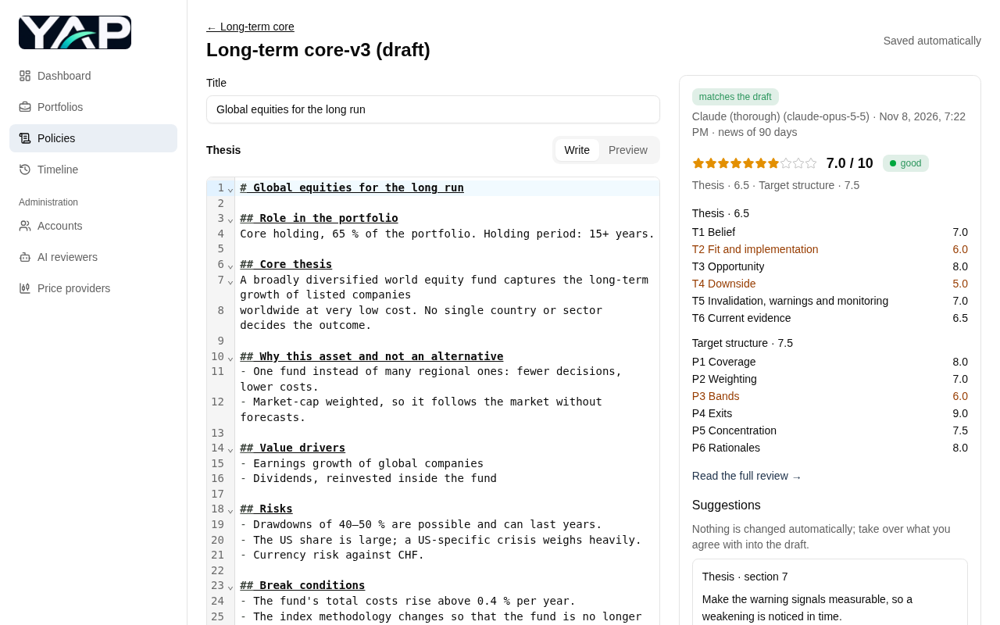

# YAP


[](https://github.com/gravity981/yap/releases/latest)
[](https://github.com/gravity981/yap/actions/workflows/ci.yml?query=branch%3Amain)
[](https://github.com/gravity981/yap/actions/workflows/dependabot/dependabot-updates)

YAP helps you invest by your own rules: you write down **why** you
invest (a thesis), turn that into a **target structure** (together a policy), compare your
**portfolios** against it and get **rebalancing instructions**. Every decision is kept, so
you can always see what you decided, when and why.

<p align="center">
  
</p>

> **Not financial advice.** YAP applies the rules you define and records your decisions;
> it gives no investment, legal or tax advice. Its rebalancing instructions are only as
> good as your policy, and its AI reviews can be wrong or incomplete. You decide and act at your own risk. Reviews send thesis texts (and for
> policy reviews, target structures) to the LLM provider configured by the admin — never
> amounts, portfolios or account names.

**[All features with screenshots →](docs/features.md)**

The full specification is in [spec/](spec/README.md):
[requirements and architecture](spec/sw-architecture.md) and
[test strategy](spec/test-strategy.md).

## Contents

- [Quick start](#quick-start)
- [Repository layout](#repository-layout)
- [Development environment](#development-environment)
- [Running the app in development](#running-the-app-in-development)
- [Building and running a production build locally](#building-and-running-a-production-build-locally)
- [Tests and checks](#tests-and-checks)
- [Generated files](#generated-files)
- [Administration](#administration)
- [Releasing](#releasing)
- [Deployment](#deployment)
- [Contributing and license](#contributing-and-license)

## Quick start

To run YAP yourself you need a Linux server in your LAN with Docker
Engine and the Docker Compose plugin. The app is served over plain HTTP: keep it inside
the LAN, never expose it to the internet.

Take the version of the [latest release](https://github.com/gravity981/yap/releases/latest)
and run on the server:

```bash
VERSION=1.2.0                                   # the latest release, without the "v"
mkdir -p ~/yap && cd ~/yap
curl -fsSL "https://github.com/gravity981/yap/releases/download/v$VERSION/yap-v$VERSION-deploy.tar.gz" | tar -xz
mv "yap-v$VERSION-deploy" prod && cd prod
cp .env.example .env                            # port 8000; adjust if needed
./deploy.sh prod "$VERSION"
docker compose exec app python -m yap.cli create-admin <username> --investor --currency CHF
```

Open `http://<server>:8000` and log in. With `--investor` your account is admin and
investor at once: it manages the accounts and has its own theses, policies and portfolios
(leave it out for an account that only manages accounts). Under **Accounts**, create
accounts for everyone else who manages investments; nobody sees another investor's data.
AI reviews are optional: under **AI reviewers**, add one or more with a provider, model and
API key of your own (Anthropic, OpenAI or Google); investors choose one per review, with a
default under **Settings** in the user menu.

**Updating:** download and unpack the new release's bundle the same way, copy its
`compose.yaml` and `deploy.sh` into `prod` (keep your `.env`), and run
`./deploy.sh prod <new version>`. It backs up the database first. Backups, rollback and
a separate staging environment are described under [Deployment](#deployment).

## Repository layout

| Path | Content |
|---|---|
| `backend/` | Python backend: domain logic, database, services, FastAPI app, admin CLI, tests |
| `frontend/` | React frontend (Vite, TypeScript, Tailwind, shadcn/ui-style components) and its tests |
| `schemas/` | JSON Schemas of the import files, generated from the backend |
| `spec/` | Specification and test strategy |
| `deploy/` | Files for the server: Compose file, `.env` example, `deploy.sh` |
| `docs/` | Feature overview with screenshots ([docs/features.md](docs/features.md)) |
| `scripts/` | Build and release scripts used by the workflows |
| `.devcontainer/` | Development container |
| `.github/` | CI, release and maintenance workflows; Dependabot |

## Development environment

The repository is set up for a VS Code devcontainer (`.devcontainer/`). Its image
provides:

- Python 3.14 with all backend dependencies (from `backend/pyproject.toml`),
- Node.js 26, the same major version as CI,
- Chromium for the end-to-end tests, in the Playwright version pinned in
  `frontend/package-lock.json`, installed under `/ms-playwright`,
- a Docker volume for the development database at `/var/lib/yap/app.db`;
  the environment variables `DATABASE_URL`, `APP_ENV=dev` and a development-only
  `APP_SECRET_KEY` are already set.

Rebuild the devcontainer after changing `backend/pyproject.toml`, the Playwright version,
or the Node version (`NODE_VERSION` in `.devcontainer/Dockerfile`).

The frontend dependencies live in the workspace (`frontend/node_modules`) and survive
rebuilds. After a fresh clone, install them once:

```bash
cd frontend
npm ci
```

The backend package is not installed; commands run from `backend`, which puts the
code on the path.

Without the devcontainer you need Python 3.14 and Node.js 26, then:

```bash
pip install -e 'backend[dev]'
(cd frontend && npm ci && npx playwright install --with-deps chromium)
export DATABASE_URL=sqlite:////absolute/path/to/app.db
```

## Running the app in development

Backend and frontend run separately; the Vite dev server forwards `/api` to the backend.

**1. Prepare the database and create an admin** (once):

```bash
cd backend
python -m yap.cli migrate
python -m yap.cli create-admin admin
```

**2. Start backend and frontend.** In VS Code, run the task **Dev: start app**
(Terminal → Run Task). It starts both servers in their own terminals; the tasks
**Dev: backend** and **Dev: frontend** start one of them. Both reload on code changes.
On Windows, clone the repository into the WSL filesystem (e.g. `~/src`), not onto a
Windows drive: a workspace mounted from Windows sends no file change events, so nothing
reloads, and it makes the tests several times slower.
Without VS Code, start them by hand:

```bash
cd backend
uvicorn --factory yap.api.app:create_app_from_env --reload --host 0.0.0.0 --port 8000
```

```bash
cd frontend
npm run dev
```

Both listen on all interfaces (`0.0.0.0`): the backend on port 8000, the frontend on
port 5173. The devcontainer forwards both ports, so the browser on the host reaches
them at <http://localhost:5173> and <http://localhost:8000>. The API documentation is
available at <http://localhost:8000/api/docs> in development.

**3. Log in.** Open <http://localhost:5173>, log in as the admin and create an investor
account under **Accounts** (or give the admin the investor role there with **Roles**). The
investor logs in with the temporary password and is asked to choose an own password first.

Reviews need LLM access: as admin, open **AI reviewers** and add one with provider
(Anthropic, OpenAI or Google), model, API key and monthly review limit per investor; "Test
connection" checks key and model. Investors choose a reviewer per review; their default is set
under **Settings** in the user menu.

The session cookie is marked `Secure`. Browsers accept it over plain HTTP only on
`localhost`, so use <http://localhost:5173>. To log in from another device through the
host's IP address, start the backend with `COOKIE_SECURE=false`.

## Building and running a production build locally

In production the backend serves the built frontend itself; there is no separate
frontend server.

```bash
cd frontend
npm run build                      # writes frontend/dist

cd ../backend
STATIC_DIR=../frontend/dist APP_ENV=prod \
  uvicorn --factory yap.api.app:create_app_from_env --port 8000
```

Open <http://localhost:8000>. The app applies database migrations on startup.

**As Docker image** (what CI and the release workflows build, spec section 5): Docker is
not installed in the devcontainer, so build it on a machine with Docker:

```bash
bash scripts/build-image.sh       # ghcr.io/gravity981/yap:local
bash scripts/smoke-test.sh ghcr.io/gravity981/yap:local "$(bash scripts/version.sh local)"
```

The image contains the version (`<last release>+local.<commit>`), runs as an unprivileged
user, keeps its database in the volume `/var/lib/yap` and listens on port
8000. `scripts/version.sh` computes the versions of all builds (spec 5.2).

Environment variables of the backend:

| Variable | Meaning | Default |
|---|---|---|
| `DATABASE_URL` | SQLite database, e.g. `sqlite:////var/lib/yap/app.db` | required |
| `APP_ENV` | `dev`, `staging` or `prod`; API docs are only served in `dev` | `dev` |
| `STATIC_DIR` | Built frontend to serve | not set (API only) |
| `APP_SECRET_KEY` | Encrypts the LLM API keys stored per AI reviewer; keep it secret and stable, a new value makes stored keys unreadable | not set (keys cannot be stored) |
| `APP_SECRET_KEY_FILE` | File containing `APP_SECRET_KEY` (a Docker Compose secret); takes precedence | not set |
| `COOKIE_SECURE` | `false` when the app is served over plain HTTP (LAN without reverse proxy), otherwise browsers drop the session cookie | `true` |
| `LLM_FAKE` | `1`: reviews get fixed answers and no LLM provider is called; only for the end-to-end tests, refused when `APP_ENV=prod` | not set |
| `MIGRATE_ON_STARTUP` | Apply migrations when the app starts | `true` |
| `APP_VERSION`, `APP_COMMIT` | Version information, set in release images | derived from git |
| `APP_VERSION_SUFFIX` | `rc.N` of a deployed release candidate, set by `deploy.sh` | – |

## Tests and checks

CI (`.github/workflows/ci.yml`) runs the same checks on every pull request and push to
`main`.

In VS Code, all tests also appear in the Testing view: backend tests (pytest, run in
`backend/`, where its configuration is), frontend unit tests (Vitest extension) and the
end-to-end scenarios (Playwright extension; run `npm run build` first, the scenarios test
the built frontend). The NPM Scripts view in the Explorer runs `lint`, `typecheck`,
`build` and the other scripts of `frontend/package.json`.

**Backend** (from `backend`):

```bash
ruff check .                     # lint
ruff format --check .            # formatting (ruff format . to fix)
mypy yap                         # type check
pytest                           # all tests
pytest --cov                     # with coverage
```

**Frontend** (from `frontend`):

```bash
npm run lint
npm run format:check             # npm run format to fix
npm run typecheck
npm test                         # all tests
npm run coverage                 # with coverage
```

**End-to-end** (from `frontend`): Playwright drives Chromium through the real app. The
tests start the backend themselves on port 8790 with a fresh temporary database and an
admin account, serving the built frontend. Reviews use a fake LLM (`LLM_FAKE=1`), so no
provider is called and no API key is needed. In the devcontainer the browser is already
installed.

```bash
npm run build
npm run e2e                                    # each step is printed as it runs
```

CI runs them on every push to `main`. Traces of failed tests are kept in
`frontend/test-results/` (`npx playwright show-trace <file>`).

**Requirement coverage** (from `backend`, after a full backend and frontend test run):

```bash
python -m yap.tools.req_report
```

Every test names the requirement IDs it verifies (`@pytest.mark.req("RB-07")` in the
backend, `[RB-07]` in frontend test names). The report lists each requirement of the
spec with its tests and fails if one has no passing test and is not on the "not yet
implemented" list in [spec/test-strategy.md](spec/test-strategy.md) §8. Only full test
runs update the results.

## Generated files

Two kinds of files are generated and committed; CI fails if they are out of date.

| Files | Regenerate with |
|---|---|
| `schemas/*.schema.json` (import file formats) | `cd backend && python -m yap.imports.schemas` |
| `frontend/src/api/schema.d.ts`, `openapi.json` (API types), `messages.json` (backend messages by code) | `cd frontend && npm run gen:api` |

Regenerate the API types whenever the backend's API changes.

The screenshots in `docs/screenshots/` are generated too, but by hand after UI changes:
`npm run build && npm run screenshots` in `frontend` (see
[docs/features.md](docs/features.md#updating-the-screenshots)).

## Administration

The admin command line runs from `backend` and uses `DATABASE_URL`:

```bash
python -m yap.cli migrate                                 # apply migrations
python -m yap.cli create-admin USERNAME                   # first admin
python -m yap.cli create-admin USERNAME --investor --currency CHF  # admin + investor
python -m yap.cli create-investor USERNAME --currency CHF # investor
python -m yap.cli backup /path/to/backup.db               # while the app runs
python -m yap.cli restore /path/to/backup.db --force      # app stopped
python -m yap.cli update-prices                           # price update now
```

Passwords are prompted for; add `--password-stdin` to read them from stdin in scripts.

## Releasing

Releases are made with GitHub Actions (spec section 5.4), from `main` only:

1. **Release candidate:** run the workflow *Release candidate* with the version, e.g.
   `1.2.0`. It checks that CI passed for the commit, runs the full test suite, builds the
   image with version `1.2.0`, pushes it as `1.2.0-rc.N`, tags the commit `v1.2.0-rc.N`
   and creates a GitHub pre-release with the deployment bundle.
2. **Verify on staging:** `./deploy.sh staging 1.2.0-rc.N`, then the checklist in
   [spec/test-strategy.md](spec/test-strategy.md) §9. A problem is fixed on `main` and
   becomes `1.2.0-rc.N+1`.
3. **Promote:** run the workflow *Promote* with the candidate, e.g. `v1.2.0-rc.2`. It
   tags the same commit `v1.2.0`, adds the image tags `1.2.0`, `1.2` and `1` to the
   same image without rebuilding, and creates the GitHub release.
4. **Deploy:** `./deploy.sh prod 1.2.0`.

CI pushes every build of `main` as `<last release>_build.<N>` and `main`; the weekly
workflow *Clean up images* deletes them after 30 days. `scripts/` holds what the workflows
run: `version.sh`, `release.sh` (the release rules), `bundle.sh`, `smoke-test.sh` and
`cleanup_images.py`.

**Dependency updates:** Dependabot ([.github/dependabot.yml](.github/dependabot.yml))
opens pull requests once a month for the backend, the frontend, the GitHub Actions and
the Docker base images: one pull request per area for minor and patch updates, major
updates separately. It only proposes releases that are at least 14 days old. CI tests
each pull request; merge it when it is green. The Node version of the devcontainer
(`NODE_VERSION` in `.devcontainer/Dockerfile`) and of CI (`node-version`) is updated by
hand together with the Node image in `Dockerfile`.

One-time settings on GitHub (repository settings):

- Branch protection (ruleset) on `main`: changes only through pull requests, with the
  CI workflow passing (NFR-13).
- Tag ruleset for `v*`: only the release workflows may create tags; nobody may move or
  delete them.
- The package `yap` (ghcr.io) gives this repository's Actions the *Admin*
  role, so the cleanup workflow may delete images.
- *Dependabot security updates* enabled (Code security), so security fixes come right
  away instead of with the monthly run.
- *Private vulnerability reporting* enabled (Code security), the channel named in
  [SECURITY.md](SECURITY.md).

## Deployment

The app runs on a server in the LAN with Docker Compose, as image
`ghcr.io/gravity981/yap` (spec section 5). It is served over plain HTTP
and must not be reachable from the internet. The files for the server are in
[deploy/](deploy/): `compose.yaml`, `deploy.sh` and `.env.example`.

**Install** (once per environment, e.g. `~/yap/prod` and
`~/yap/staging`), on a server with Docker and Docker Compose:

1. Copy the three files from `deploy/` into the environment's directory.
2. `cp .env.example .env` and adjust it. For staging: `APP_ENV=staging`, its own
   `COMPOSE_PROJECT_NAME`, `DB_VOLUME` and `APP_PORT`, and `PROD_BACKUP_DIR` pointing at
   the prod backup folder.
3. Only for a private image (e.g. in a fork): put a GitHub token with `read:packages`
   into the file `ghcr-token` (`chmod 600 ghcr-token`) and set `GHCR_USER` in `.env`.
   The published image needs no login.

**Deploy:**

```bash
./deploy.sh prod 1.2.0               # releases only (X.Y.Z)
./deploy.sh staging 1.2.0-rc.1       # any image tag
```

`deploy.sh` pulls the image, logging in to ghcr.io first if `ghcr-token` exists. On the
first deployment it creates `secrets/app_secret_key`, which encrypts the LLM API keys;
never change or delete it, and back it up separately from the database. Before a prod
deployment it backs up the running database to `BACKUP_DIR`; staging starts from the
newest prod backup instead (before the first release, when there is none, it keeps its
own database). Then it starts the new version and waits until `/api/health` reports it.
The app applies migrations on startup. After the first deployment, create the admin:

```bash
docker compose exec app python -m yap.cli create-admin <username>
```

**Backups** at any time, e.g. from cron (`BACKUP_DIR` is `/backups` in the container;
removing old backups is up to you):

```bash
docker compose exec -T app python -m yap.cli backup /backups/$(date +%F).db
```

**Rollback:** if a deployment fails, `deploy.sh` prints the command, e.g.
`./deploy.sh prod 1.1.0 --restore prod-20261102T101500Z-1.1.0.db`. It restores the
backup taken before the failed deployment, because migrations only move forward; data
entered in between is lost.

## Contributing and license

Contributions are welcome; see [CONTRIBUTING.md](CONTRIBUTING.md) and the
[Code of Conduct](CODE_OF_CONDUCT.md). Report security problems privately as described in
[SECURITY.md](SECURITY.md).

Copyright (C) 2026 gravity981. YAP is free software under the
[GNU Affero General Public License v3.0 or later](LICENSE): you may use, change and share
it, and if you run a changed version for others over a network, you must offer them its
source code. The licenses of the third-party libraries in the frontend are served by the
app at `/third-party-licenses.txt`; those of the backend come with each installed package.
