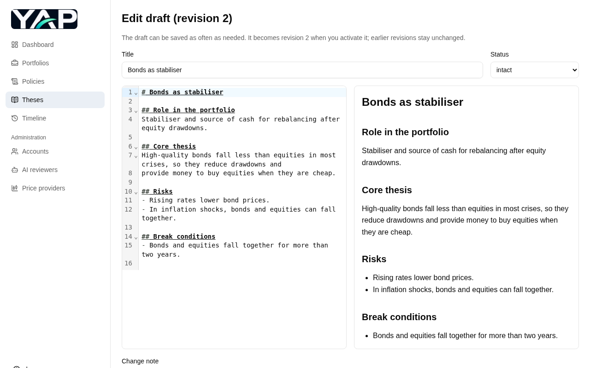
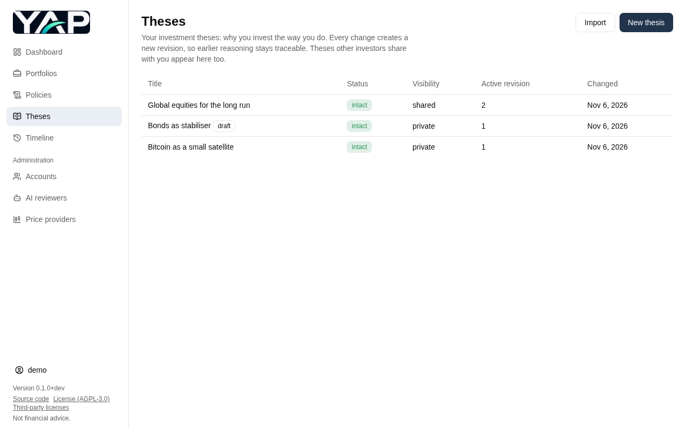
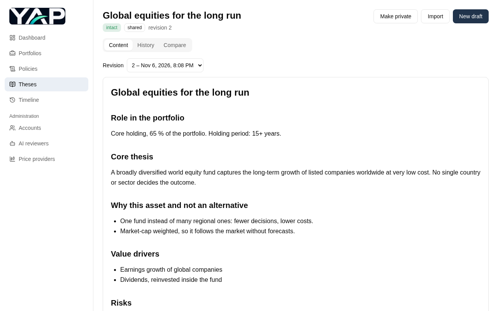
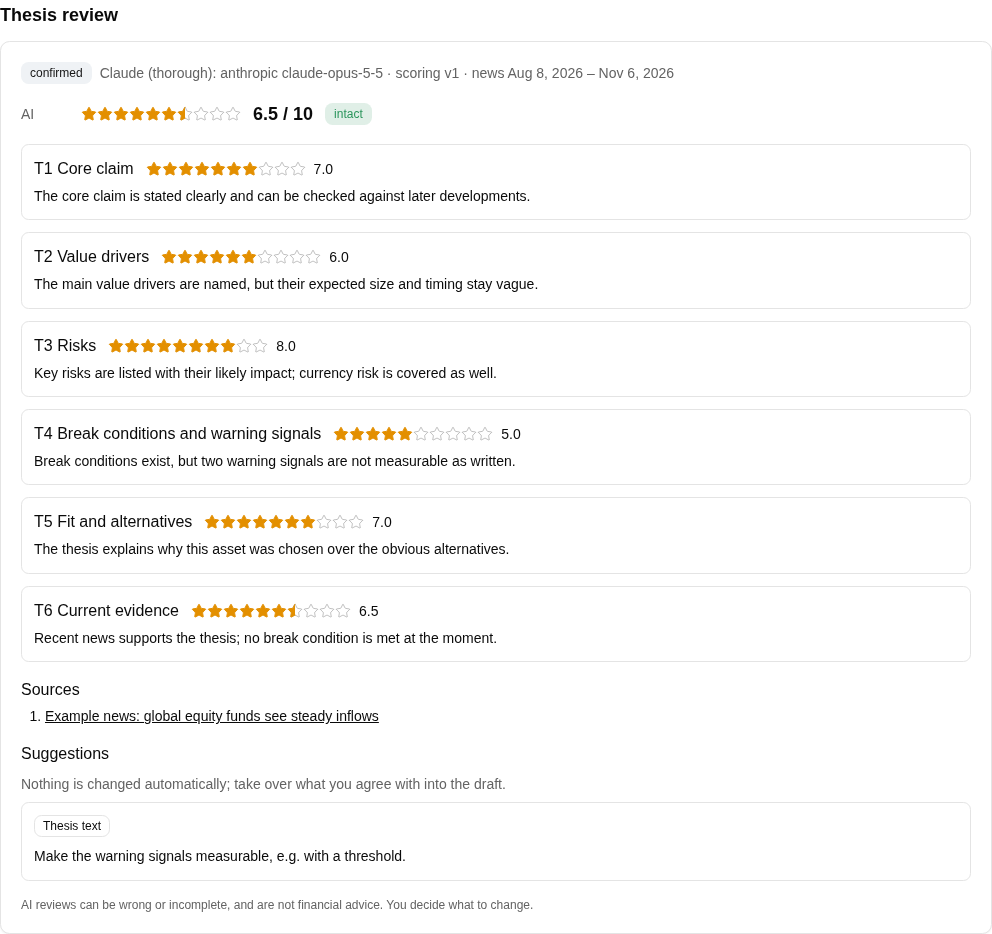

# Features

A web app for managing investment strategies: investors write theses, derive policies
(thesis + target structure) from them, compare their portfolios against the policy that
applies, get rebalancing instructions and keep a consistent history of every decision.
It runs on a server in the home LAN and supports several investors, each with their own
login.

The screenshots show fictional demo data. They are generated with `npm run screenshots`
(see [Updating the screenshots](#updating-the-screenshots)).

> **Not financial advice.** The app applies the rules you define; it gives no
> investment, legal or tax advice, and its AI reviews can be wrong.

- [Dashboard](#dashboard)
- [Theses](#theses)
- [Policies](#policies)
- [Portfolios](#portfolios)
- [Rebalancing](#rebalancing)
- [AI reviews](#ai-reviews)
- [Timeline](#timeline)
- [Administration](#administration)
- [On the phone](#on-the-phone)
- [English and German](#english-and-german)
- [Self-hosted](#self-hosted)

## Dashboard

All portfolios at a glance: how many positions are outside their band, warnings about the
theses behind your policies (broken, or a newer revision available) and your latest
decisions.


## Theses

A thesis explains why you hold an asset: its role, value drivers, risks, break
conditions and warning signals. You write it in Markdown, starting from a template, with a
live preview next to the editor.



- Every change is a draft first. Activating it creates a new revision; earlier revisions
  never change, so old reasoning stays traceable.
- Compare any two revisions side by side.
- Each thesis has a status: *intact*, *needs adaptation* or *broken*.
- Share a thesis with the other investors on your server, or keep it private.
- Import and export theses as JSON files.





## Policies

A policy combines one thesis revision with a target structure: each position with its
target share, a band (buy below, sell above), an optional exit flag and a rationale. Cash
buffers, ETFs, stocks and crypto are supported. Policies have versions as well; a version
always points to the exact thesis revision it was made for.


## Portfolios

Enter the units of a portfolio's positions (or import them) and see at once how far each
position is from its target, whether it is within its band, and how the portfolio is split
by asset type. Prices come from price providers where your assets are listed, converted into
the portfolio's currency; for anything else you enter the price, and the one last entered is
pre-filled. Each snapshot keeps the prices it was taken with, so earlier comparisons and
rebalances never change.

When you add a ticker, the app looks it up at the price providers: one listing is used
right away, with several (e.g. on SIX and in London) you choose. Your choices are in your
settings, where you can switch to another listing or to manual prices at any time.


## Rebalancing

A rebalance starts from the current values: you check the units and prices first. From
them, an optional contribution or withdrawal and the policy's rules, the app calculates what
to do: buy dips from the cash buffer, sell what is above its band, buy what is below target,
with the units and amounts per broker. Positions traded in whole units are rounded (buys
down, sells up); what that leaves over is shown, not invested. A withdrawal is paid from the sells first;
anything missing is sold from the positions furthest above target. The instructions can be printed or saved as PDF. After
trading, you confirm what was actually executed; the rebalance and the resulting values are
stored. A simulation shows how several rebalancing cycles would play out.


## AI reviews

An AI reviewer judges a thesis draft or a policy draft on six fixed aspects, each scored
from 0 to 10 in half points, with its reasoning:

- **Thesis review:** core claim, value drivers, risks, break conditions and warning
  signals, fit and alternatives, and current evidence from a web search for recent news,
  with sources. It also gives a verdict: intact, needs adaptation or broken.
- **Policy review:** how well the target structure matches its thesis (coverage,
  weighting, bands, exits, concentration, rationales). It sends no amounts.

Suggestions are never applied automatically, and the result itself cannot be changed: run
the review again instead. Activating the draft confirms the review, and
it stays with that revision. For each review you choose which AI reviewer to use; your
default is set in your settings.



## Timeline

The history of your decisions: thesis revisions, policy activations, portfolio changes,
confirmed rebalances and confirmed reviews, filterable by portfolio, policy, period and
type.


## Administration

The app supports several investors on one server, each with their own login and data; no
one sees another investor's portfolios. Admins create the accounts, and one account can be
admin and investor at the same time.


Admins also set up the AI reviewers: any number of them, each with its provider
(Anthropic, OpenAI or Google), model, API key and a monthly limit of reviews per investor.
API keys are stored encrypted and never shown again.


Admins also choose the price providers (EODHD, Yahoo Finance, CoinGecko), each with an
optional daily call limit, and when the prices are updated (e.g. once a day after the
markets close). Exchange rates come from the ECB; nothing about your portfolios is sent to
the providers, only tickers and currency codes.

## On the phone

The layout adapts to small screens; the navigation becomes a menu.


## English and German

The app is available in English and German (Swiss spelling and formats, e.g. `1’234.50`
and `02.11.2026`). Each account chooses its language in its settings; without a choice, it
follows the browser.

## Self-hosted

The app runs as a single Docker image on a server in your LAN, with a SQLite database,
backups by command and a deployment script with rollback. See the
[Quick start](../README.md#quick-start) to run it yourself.

## Updating the screenshots

The images are made by a Playwright script against the real app, with a fresh database,
fictional demo data and the fake LLM of the end-to-end tests (no provider is called). From
`frontend`:

```bash
npm run build
npm run screenshots          # writes docs/screenshots/*.png
SCREENSHOT_LANGUAGE=de SCREENSHOT_DIR=/tmp/de npm run screenshots   # German, elsewhere
```

The script is [frontend/screenshots/features.spec.ts](../frontend/screenshots/features.spec.ts);
it is not part of CI.
