# Features

A web app for managing investment strategies: investors write policies (an investment
thesis and the target structure that follows from it) in one editor, have them reviewed,
compare their portfolios against the policy that applies, get rebalancing instructions and
keep a consistent history of every decision.
It runs on a server in the home LAN and supports several investors, each with their own
login.

The screenshots show fictional demo data. They are generated with `npm run screenshots`
(see [Updating the screenshots](#updating-the-screenshots)).

> **Not financial advice.** The app applies the rules you define; it gives no
> investment, legal or tax advice, and its AI reviews can be wrong.

- [Dashboard](#dashboard)
- [Policies](#policies)
- [Portfolios](#portfolios)
- [Rebalancing](#rebalancing)
- [AI reviews](#ai-reviews)
- [Timeline](#timeline)
- [Administration](#administration)
- [On the phone](#on-the-phone)
- [English and German](#english-and-german)
- [Self-hosted](#self-hosted)

## Dashboard

All portfolios at a glance: how many positions are outside their band, the thesis status of
the policy behind each of them (good, warning, broken) and your latest decisions.

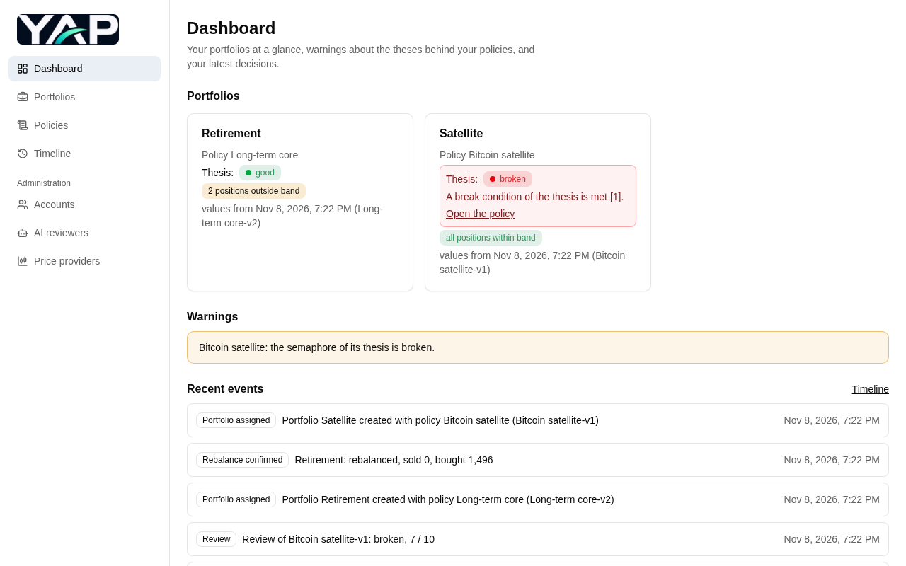

## Policies

A policy is one document: the **thesis** (why you invest, written in Markdown from a
template, with a live preview) and the **target structure** (each position with its target
share, a band to buy below and sell above, an optional exit flag and a rationale). Cash
buffers, ETFs, stocks and crypto are supported.

- **Drafts.** You edit a draft that saves itself; nothing changes until you finalize it.
  Finalize shows a summary: the review, the sum of the targets, the changes against the
  active version and the portfolios that follow the policy. Then you activate it as a new
  version. Earlier versions never change, so old reasoning stays traceable.
- **One review of everything** (next to the editor, see [AI reviews](#ai-reviews)).
- **Versions** can be compared side by side, and so can reviews.
- **Sharing.** Keep a policy private, or share its thesis, or thesis and target structure,
  with the other investors on your server. Portfolios always stay private.
- Import and export thesis and target structure as JSON files.

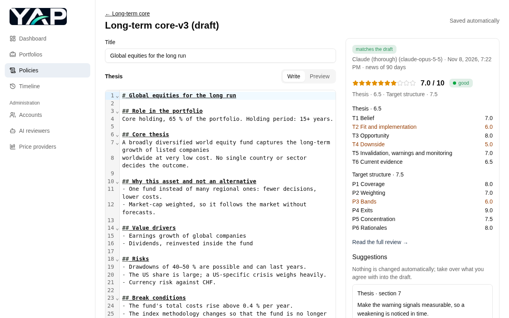

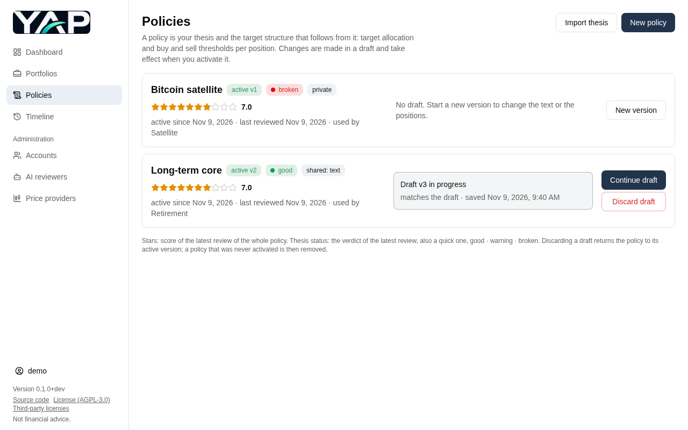

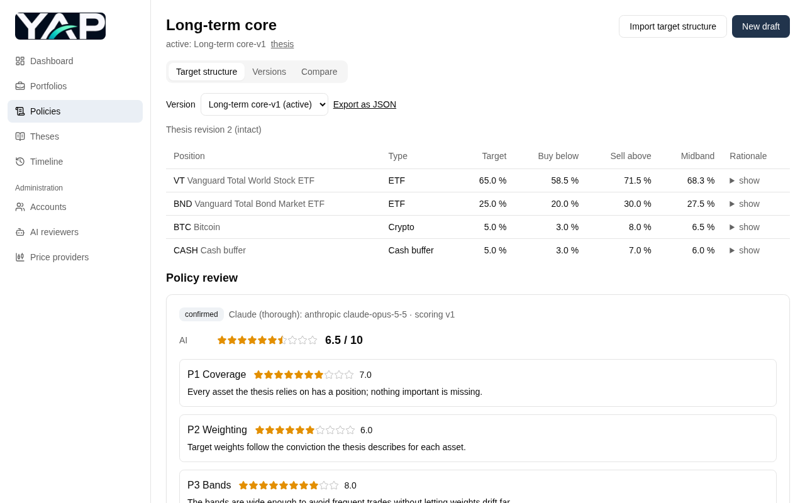

## Portfolios

Enter the units of a portfolio's positions (or import them) and see at once how far each
position is from its target, whether it is within its band, and how the portfolio is split
by asset type. Prices come from price providers where your assets are listed, converted into
the portfolio's currency; for anything else you enter the price, and the one last entered is
pre-filled. Each snapshot keeps the prices it was taken with, so earlier comparisons and
rebalances never change. The history tab shows how the share of each position developed
over the snapshots as a line chart (the four largest positions, the rest together as
"other"), above the list of past snapshots.

When you add a ticker, the app looks it up at the price providers: one listing is used
right away, with several (e.g. on SIX and in London) you choose. Your choices are in your
settings, where you can switch to another listing or to manual prices at any time.

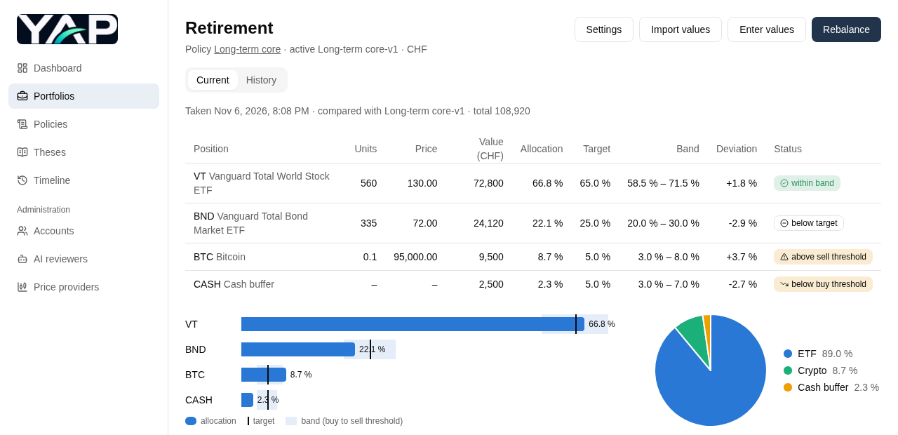

## Rebalancing

Recording values and rebalancing are separate: values are entered only on the "Enter
values" screen. A rebalance starts from the latest recorded values; if they are older than
3 days it warns "values outdated, recommendation: update first" with a link to the values
screen, but you can still go on. To update values you leave the rebalance and record them.
From the values, an optional contribution or withdrawal and the policy's rules, the app calculates what
to do: buy dips from the cash buffer, sell what is above its band, buy what is below target,
with the units and amounts per broker. Positions traded in whole units are rounded (buys
down, sells up); what that leaves over is shown, not invested. A withdrawal is paid from the sells first;
anything missing is sold from the positions furthest above target. The instructions can be printed or saved as PDF. When
you decide to go ahead, you confirm the rebalance: that means the trades will be carried out
as calculated, not that they were. Nothing is adjusted at confirmation and no values are
stored; after trading, you record the new values. A simulation shows how several rebalancing cycles would play out.

The thesis status informs you; it never trades for you. With a **warning**, the page shows
an amber hint with the reason of the latest review and a link to the policy; the calculation
stays as usual. With a **broken** thesis, the page shows the reason in red and asks how you
want to rebalance: **sell the whole portfolio** (preselected: every position is sold
completely, nothing is bought, the cash stays in the portfolio unless you enter a
withdrawal) or rebalance as usual. The choice is stored with the confirmed rebalance and
named in the timeline.

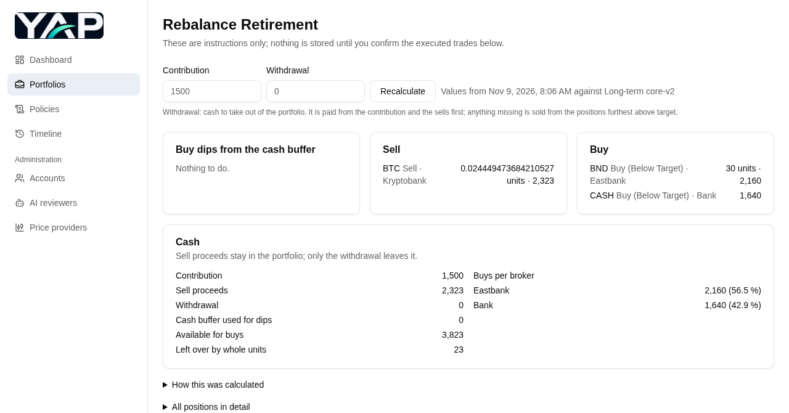

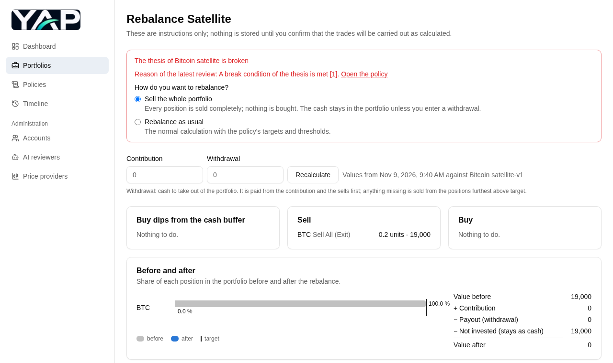

## AI reviews

An AI reviewer (or an AI of your choice, by copying a prompt and pasting its answer) reviews
the whole policy at once: six aspects of the thesis (belief, fit and implementation,
opportunity, downside, invalidation, warnings and monitoring, current evidence from a web
search for recent news, with sources) and six of the target structure (coverage, weighting,
bands, exits, concentration, rationales). Each is scored from 0 to 10 in half points, with
its reasoning. The review gives a score and the thesis a **status**: *good*, *warning* or
*broken*, with a reason.

- **Suggestions** change a thesis section or a position (change, add, remove) and are never
  applied automatically: take them over with a click (and undo it), or dismiss them, which
  deletes them. Activating the draft removes the ones that are left.
- **Proposals:** when a policy has no positions yet, the review proposes target structures.
- A review **warns, never blocks**: you can activate a draft without a review or with a
  review that no longer matches; the version is marked, and you confirm.
- A **quick review** can be run on the active version any time, without a new version: it
  only checks the verdict against current news. The score stays as the last full review set
  it, and there are no suggestions. Only a draft gets a review of the whole policy; the
  Finalize page strongly recommends completing it before you activate. All results are kept
  in a review log that you can compare, and the latest one sets the thesis status shown on the
  policy and on its portfolios.

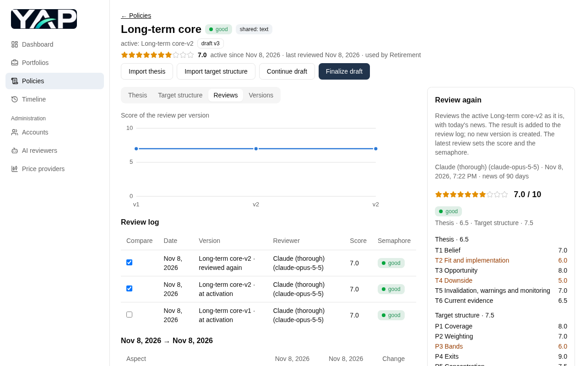

For each review you choose which AI reviewer to use; your default is in your settings.

## Timeline

The history of your decisions: policy activations, portfolio changes, confirmed
rebalances (also when a whole portfolio was sold) and reviews, filterable by portfolio,
policy, period and type. Each entry opens its details.

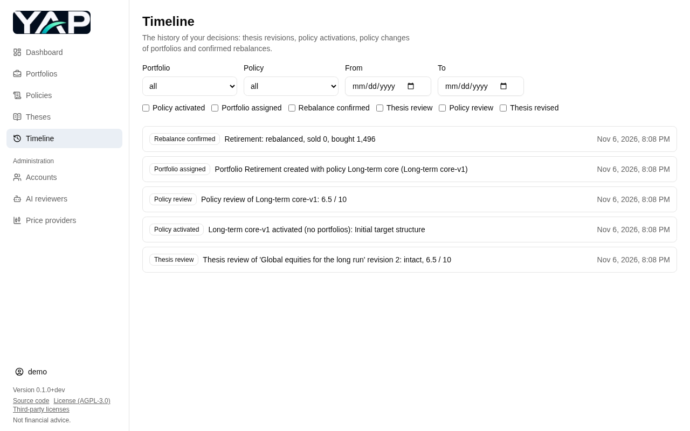

## Administration

The app supports several investors on one server, each with their own login and data; no
one sees another investor's portfolios. Admins create the accounts, and one account can be
admin and investor at the same time.

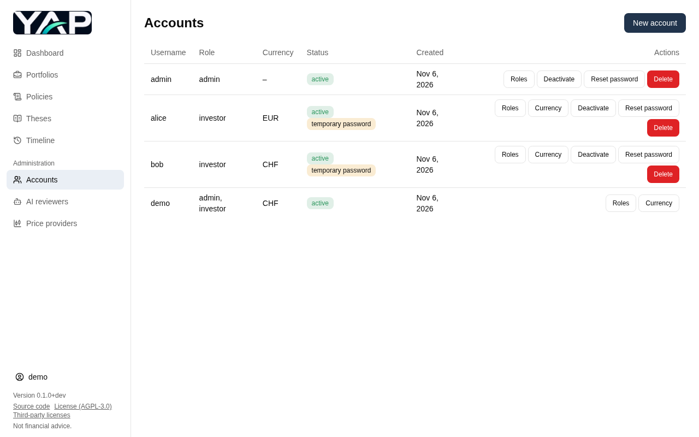

Admins also set up the AI reviewers: any number of them, each with its provider
(Anthropic, OpenAI or Google), model, API key and a monthly limit of reviews per investor.
API keys are stored encrypted and never shown again.

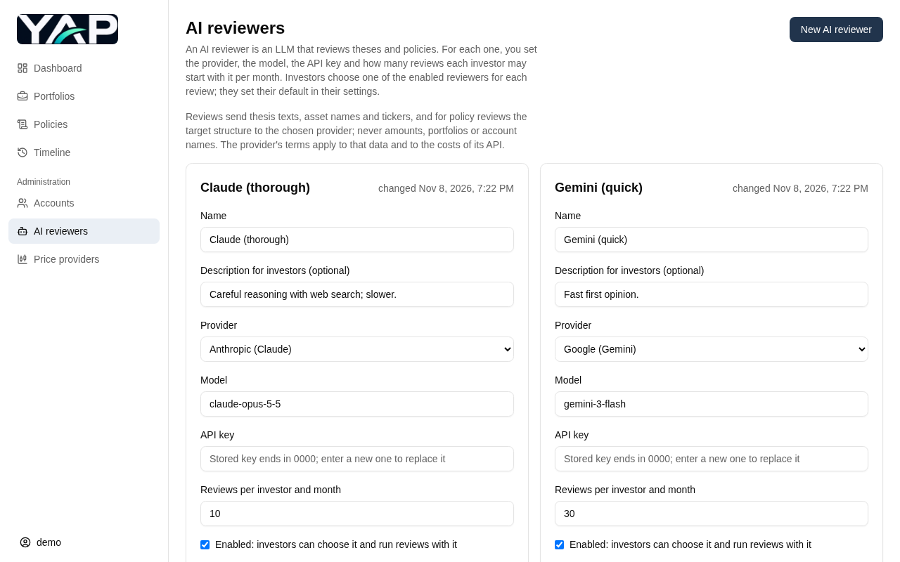

Admins also choose the price providers (EODHD, Yahoo Finance, CoinGecko), each with an
optional daily call limit, and when the prices are updated (e.g. once a day after the
markets close). Exchange rates come from the ECB; nothing about your portfolios is sent to
the providers, only tickers and currency codes.

## On the phone

The layout adapts to small screens; the navigation becomes a menu.

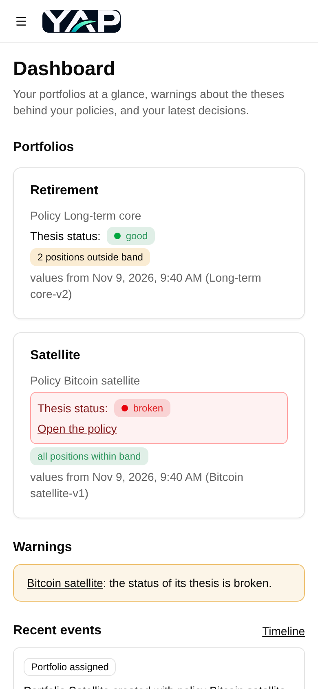

## English and German

The app is available in English and German (Swiss spelling and formats, e.g. `1’234.50`
and `02.11.2026`). Each account chooses its language in its settings; without a choice, it
follows the browser.

## Self-hosted

The app runs as a single Docker image on a server in your LAN, with a SQLite database,
backups by command and a deployment script with rollback. See the
[Quick start](../README.md#quick-start) to run it yourself.

## Updating the screenshots

The images are made by a Playwright script against the real app, with a fresh database,
fictional demo data and the fake LLM of the end-to-end tests (no provider is called). From
`frontend`:

```bash
npm run build
npm run screenshots          # writes docs/screenshots/*.png
SCREENSHOT_LANGUAGE=de SCREENSHOT_DIR=/tmp/de npm run screenshots   # German, elsewhere
```

The script is [frontend/screenshots/features.spec.ts](../frontend/screenshots/features.spec.ts);
it is not part of CI.
