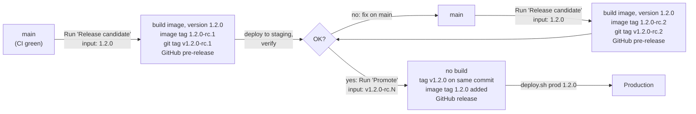

# Software Architecture

## 1. Application Type

### 1.1 Decision drivers

| Driver | Implication |
|---|---|
| Several investors, each with their own login | Needs authentication and strict separation of each investor's data |
| Runs on a server in the home LAN, not on the public internet | Reached from any device in the LAN (laptop, phone); no public hosting, but traffic crosses the network |
| Personal financial data | Data stays on the own server; passwords and sessions must be protected |
| Theses can be shared between investors | Thesis is a shared entity with an owner; policies and portfolios stay private |
| Theses and target structures are written as markdown | Markdown is the content format; versioning has to work for several users |
| The tool manages investment strategies, not portfolio value | Snapshots are taken only when needed for a comparison or a rebalance. Prices come from price providers where possible, so the investor enters units instead of looking up values. Listings keep only their latest price and portfolios are not valued between snapshots, but every snapshot keeps the prices it was taken with, so past comparisons, rebalances and decisions never change |
| History must stay consistent when the policy changes | Every comparison is tied to the policy version that was active at the moment the snapshot was taken |
| Plan-vs-reality comparison and decision timeline | Benefits from tables and charts |
| News lookup and thesis assessment | Needs internet access and an LLM API; started on demand, runs in the background |
| Exact money arithmetic and data handling | Python (decimal arithmetic, mature data and web libraries) suits the backend |

### 1.2 Options

| Option | Strengths | Weaknesses |
|---|---|---|
| **Script / CLI** | Smallest effort; easy to automate | No logins, no shared access from other devices; poor for data entry, history views and timeline |
| **Web app on a LAN server** | One installation serves all investors on all devices; forms, tables, charts and rendered markdown in the browser; Python backend reuses existing code | Needs authentication, a reverse proxy and a deployment setup |
| **Native app** | Offline, OS integration | Per-platform builds; still needs a server for shared theses and multiple investors; no reuse of the Python code |

### 1.3 Decision

**Web app, served from a server in the home LAN, with a login per investor.**

- **Core library** (Python): domain model (investor, thesis, policy, portfolio, snapshots, rebalances, reviews), allocation comparison, rebalancing logic. Has no UI or web dependencies.
- **Web API + UI** on top of the core: login, policy and thesis editing, entering portfolio values, comparison against the policy, rebalancing, thesis reviews, timeline.
- **Background jobs** on top of the core: thesis and policy reviews (on demand only) and the scheduled price update (PRC-07).
- **CLI** on top of the same core for admin tasks (create investor accounts, backup) and for development.

**Repository layout**

| Path | Content |
|---|---|
| `backend/` | Python backend: core library, FastAPI app, CLI, migrations, tests |
| `frontend/` | React frontend and its tests |
| `schemas/` | Generated JSON Schemas for imports (IMP-09) |
| `spec/` | Specification and test strategy |
| `deploy/` | Files for the server: Compose file, `deploy.sh` (section 5.6) |
| `scripts/` | Build and release scripts used by the workflows (section 5) |
| `.github/workflows/` | CI and release workflows (section 5) |

### 1.4 Multi-investor model

| Entity | Ownership | Visibility |
|---|---|---|
| Investor (user account) | – | Own account only; the admin role manages accounts; one account can have both roles (USR-09) |
| Thesis | Owned by one investor | `private` (owner only) or `shared` (all investors can read it and use it in their policies, and it is listed in the catalog, THS-11); only the owner edits it |
| Example thesis | Built into the app, owned by no one | Readable by all investors in the catalog (THS-13); can only be copied, not edited or pinned |
| Policy (versions) | Owned by one investor; an investor has any number of policies | Owner only; each version pins exactly one thesis revision (own or shared) |
| Portfolio | Owned by one investor; an investor has any number of portfolios | Owner only; assigned to exactly one of the owner's policies |
| Snapshots, rebalances | Belong to one portfolio | Owner only |
| Thesis review | Started by one investor for a thesis revision | General assessment: same visibility as the thesis. Parts about the investor's own portfolio: that investor only |

Theses are stored as markdown text in the database, with a revision history. Existing theses and target structures can be brought in through the JSON import (section 3.10).

An investment policy statement is not kept as a separate document. Its usual parts are covered as follows: the rebalancing rules are hardcoded in the app (section 3.7), the thesis rules go into the thesis template and the theses (THS-07), and the rest is replaced by policies and portfolios.

### 1.5 Decisions

1. **Policy = one thesis + one target structure.** Each policy version pins exactly one revision of one thesis (own or shared); the same thesis can be used by several policies. Positions of the target structure do not reference theses. A policy version is immutable once activated. When the thesis changes, the active policy version keeps the revision it pinned; the investor sees that a newer revision exists and can take it over into a new policy version.
2. **Policies and portfolios.** An investor has one or more policies and zero or more portfolios. Every portfolio is assigned to exactly one policy; a policy can be used by several portfolios or by none. A portfolio cannot exist without a policy.
3. **One active version per policy at a time, with recorded activation times.** Every portfolio snapshot is compared against the version of the portfolio's policy that was active at the moment the snapshot was taken. Activating a new version never changes the comparison of earlier snapshots. All points in time are exact timestamps in UTC (NFR-14), not calendar days.
4. **Strategy management, not value tracking.** The investor takes a snapshot when they want a comparison or a rebalance. A snapshot holds units and a price per position: the price comes from a price provider if the asset is available there (section 3.11), otherwise the investor enters it. The app keeps only the latest price of each listing and values portfolios only in snapshots. Each snapshot keeps the units, prices and exchange rates it was taken with (CMP-10); a confirmed rebalance refers to its input snapshot and stores its result as a snapshot at the same prices (RB-17). Later prices never change past snapshots, rebalances or timeline events. Each portfolio has one currency; prices in other currencies are converted into it.
5. **Rebalancing on demand, per portfolio.** The investor triggers "Rebalance" for a portfolio when they want instructions. Only a confirmed rebalance is stored, as an event in the timeline.
6. **Review in the editor, required for activation.** The investor reviews a thesis or policy draft while editing it, with a configured AI reviewer (a background job) or manually with an external AI (section 3.9). Every activation needs a current review; there are no scheduled reviews or notifications. The confirmed review is stored with the revision or version and as an event in the investor's timeline.
7. **Accounts created by an admin only.** There is no self-registration. The admin creates accounts (in the web UI or through the CLI) and can reset passwords.

## 2. Technology Stack

### 2.1 Backend

**Python with FastAPI** (decided).

- Serves a JSON API for the frontend; generates an OpenAPI schema automatically.
- Pydantic models validate input (e.g. position values, contribution amounts) and define the API contract.
- The core library stays framework-independent; FastAPI is a thin layer on top.

### 2.2 Authentication and authorization

- Username + password login; passwords hashed with Argon2.
- Server-side sessions in an `HttpOnly`, `SameSite=Strict` cookie, marked `Secure` unless `COOKIE_SECURE=false` (needed for plain HTTP, see 2.6). The SPA is served from the same origin as the API, so no tokens are handled in JavaScript.
- Every investor-owned table has an `investor_id`. All queries go through a repository layer that filters by the logged-in investor; API endpoints never take an investor id from the client.
- Roles: `investor` and `admin`; an account has one or both (USR-09). No self-registration; only the admin creates accounts.

### 2.3 Frontend

| Option | Strengths | Weaknesses |
|---|---|---|
| **React + Vite + TypeScript** | Largest ecosystem; polished component libraries (shadcn/ui); mature charting, table and markdown libraries; best tooling and AI-assistant support | More boilerplate than Svelte |
| SvelteKit | Less code, fast, pleasant to write | Smaller ecosystem; fewer ready-made components for tables and charts |
| Vue + Vite | Gentle learning curve, good component libraries | Smaller ecosystem than React |
| Python UI (NiceGUI, Streamlit, Reflex) | Single language, no separate build | Limited control over design; harder to make it look and feel polished |

**Proposal: React + Vite + TypeScript**, as a single-page app served by FastAPI.

| Concern | Library |
|---|---|
| UI components | shadcn/ui (Radix + Tailwind CSS) |
| Server state / API calls | TanStack Query, with a typed client generated from the FastAPI OpenAPI schema |
| Forms and validation | React Hook Form + Zod |
| Tables | TanStack Table |
| Charts | Small SVG/HTML components of our own (bars per position, pie by type, CMP-07); no chart library needed |
| Markdown rendering and editing | react-markdown (view); a markdown editor component for editing theses |
| Routing | TanStack Router or React Router |

No server-side rendering (Next.js) is needed: a handful of users in a LAN gain nothing from it, and it would add a second server.

**UI decisions**

- Layout: left sidebar (Dashboard, Portfolios, Policies, Theses (with the tabs "My theses" and "Catalog", THS-11), Timeline for investors; Accounts, AI reviewers and Price providers for admins, under the heading "Administration" for an account with both roles; Settings in the user menu for every account), collapsing to a menu on phones. The start page is a dashboard: all portfolios with the band status of their latest snapshot, warnings (broken thesis, newer thesis revision available) and recent timeline events.
- Markdown editing: CodeMirror source editor next to a live preview (stacked tabs on phones); the stored markdown is exactly what was typed.
- PDF report (RB-19): a print-optimised report page, saved via the browser's print dialog ("Save as PDF"); no server-side PDF rendering.
- Theme: light and dark, following the device setting, with a manual toggle in the user menu.
- In development the Vite dev server proxies `/api` to the backend; in production FastAPI serves the built frontend.

### 2.4 Database

A handful of investors on a LAN server do not need PostgreSQL. The write volume is tiny (edits, snapshots, rebalances, reviews), and SQLite in WAL mode lets many readers work while one write happens; writes take milliseconds, so investors never notice they are serialized.

| Option | Strengths | Weaknesses |
|---|---|---|
| **SQLite (WAL mode)** | One file, no extra service; easy backup; enough for a few concurrent users | One writer at a time; no database-level user permissions |
| PostgreSQL | Many concurrent writers; row-level security; standard for larger multi-user apps | Extra container to run, update and back up |
| DuckDB | Excellent for analytics over history | Built for analytics, not for transactional writes from a web app |

**Proposal: SQLite**, accessed through **SQLAlchemy 2.0** with **Alembic** migrations.

- Run with `journal_mode=WAL` and a `busy_timeout`, so a background job and a user edit never fail on a lock.
- SQLAlchemy keeps the code database-agnostic. Switch to PostgreSQL if the app outgrows the household (dozens of users, several app servers) or is exposed beyond the LAN.
- Monetary values are stored as `Decimal` (SQLAlchemy `Numeric`), never as floats.
- Thesis revisions, policy versions, portfolio snapshots, confirmed rebalances and thesis reviews are append-only: a change creates a new row instead of updating the old one. This gives the consistent history the app needs.
- Backups use SQLite's online backup (`sqlite3 app.db ".backup ..."`), not a plain file copy while the app runs.
- There are two databases, each in its own Docker volume; neither is ever committed:

  | Environment | Volume | Mounted in | Path in container |
  |---|---|---|---|
  | dev | `yap-db-dev` | devcontainer ([.devcontainer/devcontainer.json](../.devcontainer/devcontainer.json)) | `/var/lib/yap/app.db` |
  | prod | `yap-db-prod` | `app` service in the production Docker Compose file on the LAN server | `/var/lib/yap/app.db` |

  The path is the same in both environments; only the volume differs. The app reads it from `DATABASE_URL` and the environment from `APP_ENV` (`dev` / `prod`). Tests never use either volume: they run against a temporary or in-memory SQLite database.

### 2.5 Background jobs

- Reviews (thesis and policy, section 3.9) run in a small in-process job runner (a worker task in the app process, job state in the database) and report progress to the UI.
- The price update (PRC-07) is the only scheduled job. An in-process scheduler starts it at the times the admin set; the next run time is stored in the database, so a restart neither skips nor repeats a run (a run missed while the app was down starts right after startup). The CLI command `update-prices` starts the same run by hand. Only one run happens at a time; an unfinished run older than an hour counts as interrupted. `PRICE_SCHEDULER=false` turns the scheduler off (end-to-end tests).
- The app runs as a single process in a single container (Uvicorn without extra workers), so no separate worker, queue or scheduler service is needed.
- A job interrupted by a restart is marked as failed and can be started again; it never leaves a partial review. An interrupted price update keeps the prices it already fetched.

### 2.6 Deployment

- Docker Compose on the LAN server:
  - `app`: FastAPI (Uvicorn) serving the API and the built React app, and running the review jobs; SQLite file in the `yap-db-prod` volume (section 2.4), `APP_ENV=prod`. Its port is published directly on the server; there is no reverse proxy.
- **Plain HTTP in the LAN** (decision 2026-11-02): no TLS, so the session cookie is sent without the `Secure` flag (`COOKIE_SECURE=false` in the deployment bundle). Accepted risk: anyone who can read the LAN traffic can read passwords and session cookies; the LAN is trusted. HTTPS can be added later with a reverse proxy in front of the app and `COOKIE_SECURE=true`, without code changes.
- Not exposed to the internet. Remote access, if ever needed, goes through a VPN (e.g. WireGuard/Tailscale), not port forwarding. Outgoing connections are needed for news search, the LLM API, the price providers and the exchange rates (section 3.11).
- LLM API keys are configured per AI reviewer by the admin (REV-14) and stored encrypted with `APP_SECRET_KEY` (REV-15); they are never sent to the browser. API keys of price providers (PRC-01) are stored the same way. On the server the secret is a file, mounted read-only as a Docker Compose secret and read through `APP_SECRET_KEY_FILE`, so it appears neither in the container environment nor in `docker inspect`. `deploy.sh` creates it once per environment and never overwrites it; it is kept apart from database backups (a backup alone reveals no API keys; without the secret only the API keys must be entered again). News search uses the LLM provider's built-in web search, so it needs no key of its own.
- How images are built, versioned, released and rolled out is described in section 5.

### 2.7 Summary

```
Browsers in LAN (laptop, phone)
        │ HTTP (LAN only)
      FastAPI ── auth (sessions, Argon2)
        │      ── React SPA (static files)
        │
   core library (Python) ── SQLAlchemy ── SQLite (WAL, volume)
        │
   background jobs (on demand): LLM thesis review (with news search), policy review
   scheduled job: price update (price providers, exchange rates)
        │
   CLI (admin: accounts, import, backup)
```

## 3. Requirements

Priorities: **M** = must, **S** = should, **C** = could.

### 3.1 Terms

| Term | Meaning |
|---|---|
| Thesis | Markdown document explaining the investment strategy of a policy and why its assets are held, including break conditions. Created from a template (THS-07) |
| Target structure | List of target positions: asset, target allocation, buy threshold, sell threshold |
| Policy | The overarching name for a strategy: one thesis plus one target structure, plus a rebalancing setting. A policy has a name and versions (e.g. `core-v1`, `core-v2`). An investor can have several policies |
| Policy version | An immutable state of a policy. It is a draft until activated |
| Active policy version | The one version of a policy that its portfolios are compared against at a given time. Each activation is recorded with its exact time |
| Portfolio | A set of positions the investor actually holds (e.g. "Main", "Long-term"), with default contribution and brokers. Assigned to exactly one policy |
| Base currency | The investor's main currency; it presets the currency of new portfolios (USR-06) |
| Portfolio currency | The one currency of a portfolio. All prices, values, amounts and contributions of the portfolio are in this currency; prices in other currencies are converted into it (PRC-11) |
| Units | The quantity of an asset held in a portfolio (shares, coins); for the cash buffer, its amount |
| Snapshot | The units, price and value of each position of a portfolio at one moment, in the portfolio currency, and its comparison against the policy version active at that moment |
| Price provider | An external service the app gets prices from (EODHD, Yahoo Finance, CoinGecko), configured by the admin (PRC-01). Exchange rates come from a built-in source (PRC-11) |
| Listing | One asset as offered by one price provider: provider, symbol, exchange, quote currency and name. The same ticker can have several listings (e.g. on SIX in CHF and on the LSE in USD) |
| Price source | Per investor and asset: the listing the investor chose (`auto`), `manual` (the investor enters prices), or `unresolved` (no listing chosen yet because the lookup could not be done; behaves like `manual`) |
| Midband | Midpoint between target allocation and absolute sell threshold: (target + absolute sell threshold) / 2. Sells after an upper band breach go down to it |
| Cash buffer | A position of type `cash buffer`; its value is used for dip buying |
| Rebalance | A calculation of buy and sell instructions for a portfolio from a snapshot and the active version of its policy. Stored only when the investor confirms it |
| Thesis review | An assessment of a thesis draft, by an AI reviewer or entered manually: a score per aspect of the thesis (section 3.9), a total score, and a verdict whether the thesis is `intact`, `needs adaptation` or `broken` based on current news |
| Policy review | An assessment of a policy draft, by an AI reviewer or entered manually: a score per aspect of how well its target structure matches the pinned thesis revision, and a total score |
| Score | 0 to 10 in steps of 0.5, shown as 10 stars with half stars. A review's total score is the average of its aspect scores |
| AI reviewer | An LLM that runs reviews, configured by the admin: name, provider, model, API key and monthly review limit per investor. There can be any number; the investor chooses one per review, with a default from their settings |
| Review method | How a review is made: one of the AI reviewers, or `manual` (REV-18) |
| Manual review | A review the investor gets from an AI outside the app: the app gives them the review prompt (REV-19), they paste the AI's JSON answer back |
| Review prompt | The complete instructions for a review: the draft's content, the aspects, the scoring rules and the JSON format of the answer. The same for AI reviewers and manual reviews |
| Not reviewed | A thesis whose latest activated revision, or a policy whose active version, has no confirmed review (activated before reviews were required, REV-20) |
| Exit flag | Per-position flag in a target structure: the investor wants to leave this asset; the rebalancing sells it completely |
| Timeline | The chronological list of an investor's strategy decisions across all policies and portfolios: policy activations, portfolio assignments, confirmed rebalances, confirmed reviews |
| Revision | A version of a thesis. Like a policy version, it is a draft until activated and immutable afterwards |

### 3.2 Users and access

| ID | Requirement | Prio |
|---|---|---|
| USR-01 | An investor logs in with username and password. All pages and API endpoints except login require a session. | M |
| USR-02 | Only an admin creates, deactivates and deletes investor accounts and resets passwords. There is no self-registration. Deactivated investors cannot log in and can be reactivated. Deleting an investor is irreversible: the account is deactivated and anonymised (username replaced by `deleted-<id>`, password removed); the history stays in the database but is unreachable. Shared theses of a deactivated or deleted investor stay readable for all other investors. A password reset sets a temporary password that the investor must change at the next login, and ends all of the investor's sessions. | M |
| USR-03 | An investor can change their own password. | M |
| USR-06 | Each investor has a base currency, set when the account gets the investor role. It presets the currency of new portfolios (PTF-03) and can be changed at any time; existing portfolios keep their currency. | M |
| USR-04 | An investor sees and changes only their own policies, portfolios, snapshots, rebalances and timeline. | M |
| USR-05 | The admin role is for account management and the configuration of the AI reviewers (REV-14) and the price providers (PRC-01); it gives no access to investors' data. Theses, policies and portfolios belong to the investor role: an account with only the admin role has none, and an account with both roles sees and changes only its own, like every investor (USR-04). | M |
| USR-09 | An account has the investor role, the admin role or both. The admin sets the roles when creating an account and can change them later, also on their own account. Giving the investor role needs a base currency (USR-06); the investor role can only be removed while the account owns no theses, policies or portfolios. The last active admin keeps the admin role. The CLI can create the first admin with the investor role too (e.g. for a single person running the app for themselves). | M |
| USR-10 | Every account chooses its UI language in its settings: English, German, or like the browser (the default). The choice is stored with the account, so it applies on every device. Before login, and for accounts without a choice, the app is German if the browser prefers German, otherwise English. | S |
| USR-11 | Every account chooses its time zone in its settings: like the browser (the default) or a named time zone (e.g. `Europe/Zurich`). The choice is stored with the account. All points in time are shown in it, and times entered in the UI (e.g. the time of day of the price update, PRC-07) are read in it (NFR-14). | S |
| USR-08 | An investor chooses the review method for each review when starting it: one of the enabled AI reviewers (REV-13) or `manual` (REV-18). A default method, set in the investor's settings and changeable at any time, is preselected; if it is an AI reviewer that is not available, the first enabled one is, and `manual` if there is none. A new investor has no default until they choose one. The settings show each reviewer's name, description, provider, model and monthly limit, and the reviews used this month with the default one; starting a review shows the usage of the reviewer chosen for it. | M |
| USR-07 | Passwords have at least 12 characters. A session ends after 30 days, or after 8 hours without activity. | M |

### 3.3 Theses

| ID | Requirement | Prio |
|---|---|---|
| THS-01 | An investor creates and edits theses in markdown, with live preview. | M |
| THS-02 | Theses are edited in drafts, like policy versions (POL-06): a new revision starts as a draft copy of the latest revision; a thesis has at most one draft at a time; a draft can be saved and edited freely and deleted (except the first revision of a new thesis). Activating the draft makes it an immutable revision. Activation requires a current review (REV-11) and is possible even if only a review was added (REV-01). Earlier revisions are kept and can be viewed; the investor can compare any two revisions, including the draft (diff). Only activated revisions can be pinned by a policy version (POL-02) and count as a newer revision (POL-10). | M |
| THS-03 | Every revision after the first needs a change note (why it changed) when it is activated. | M |
| THS-04 | A thesis has a status: `intact`, `needs adaptation` or `broken`. Only the owner changes it, in a draft, never the system. There is no "soft break" status beyond these; weakening of a thesis is also expressed by the scores of its reviews (REV-03). `needs adaptation` and `broken` have no automatic effect on rebalancing; they are shown as a warning on every policy and portfolio that uses the thesis, and the investor acts on them with a new thesis revision or with exit flags (POL-11). | M |
| THS-05 | A thesis is `private` or `shared`. Only a thesis whose latest activated revision has a confirmed review can be shared (REV-20). Shared theses are readable by all investors; only the owner edits them. If the owner makes a shared thesis private again, investors whose policy versions reference one of its revisions keep read access to exactly those revisions (and their reviews). | M |
| THS-07 | New theses can be created from the template below, in English or German (the account's UI language). It is plain markdown, so it can also be copied into other tools and back. Its sections match the thesis review aspects (section 3.9). A thesis may list several assets in its Implementation section. | S |
| THS-08 | Each thesis has a history view listing its activated revisions with their confirmed reviews (REV-11) in chronological order, including the course of the total review score over time. | M |
| THS-10 | An investor can copy a catalog entry (an example thesis or a shared thesis, THS-11) into a new private thesis of their own: its first revision is a draft with the title, markdown content and status of the source (the latest activated revision of a shared thesis). The copy is independent: later changes to the source do not affect it, and it has none of the source's revisions or reviews. | M |
| THS-11 | **Catalog.** The theses area has two tabs: "My theses" lists the investor's own theses (private and shared); "Catalog" lists the example theses (THS-13) and the shared theses of all other investors, each with its latest activated revision. A thesis appears in the catalog as soon as its owner shares it and disappears when it is made private again (THS-05 still applies to policies that pin it). Shared theses without an activated revision are not listed. Policies can still pin shared theses directly (POL-01), without copying them. | M |
| THS-12 | Each catalog entry shows its title, its source (`Example`, or the owner's username), its status, the date of its latest activated revision and the total score of its latest confirmed thesis review, if any. The catalog can be searched by title and text and filtered by source (examples / shared). Opening an entry shows its rendered markdown, with the actions "Copy to my theses" (THS-10) and, for shared theses, "Open" (the existing read-only thesis page with its history). | S |
| THS-13 | **Example theses** are part of the app: written in English and German, shipped and versioned with each release, and shown in the account's UI language (USR-10). They follow the thesis template (THS-07), have the status `intact`, and start with a note that they are examples, not investment advice. They are read-only, have no revisions and no reviews, and cannot be pinned by a policy version; they are used only by copying them. The first set covers at least: a broad global equity ETF as core holding, a cash buffer, a single stock and a crypto position. | M |
| THS-14 | A copied thesis records its origin (the example and the app version, or the source thesis and revision number) and shows "Copied from …" on its page; for a shared source the link works as long as the investor can read it. The catalog marks entries the investor has already copied. | S |
| THS-15 | When an investor has no theses yet, the "My theses" tab and the dashboard point to the catalog and to creating a thesis from the template (THS-07). | S |

**Thesis template** (THS-07; the German version has the same structure):

```markdown
# Investment Thesis

## 1. Belief — What do I think?
Describe the investment idea in 2–5 sentences. What do I believe, and why is this opportunity attractive?

## 2. Investor Fit — Is this appropriate for me?
- **Investor type:** Conservative / Balanced / Growth / Aggressive
- **Investment horizon:** Short-term / Medium-term / Long-term
- **Risk tolerance:** Low / Moderate / High
- **Risk capacity:** Low / Moderate / High
- **Liquidity needs:** Low / Moderate / High

## 3. Implementation — Which assets express my thesis?
List the selected assets and explain why they are suitable for expressing the investment thesis.

- **Asset name (TICKER):**
- **Role in portfolio:**
- **Selection rationale:**

## 4. Opportunity — What creates value?
Describe the factors that could create value and generate investment returns.

- Value driver 1:
- Value driver 2:

## 5. Downside — What can go wrong?
Identify the risks that could negatively affect the investment thesis.

- Risk 1:
- Risk 2:

## 6. Invalidation — When am I wrong?
Define the conditions that invalidate the investment thesis.

When one of these conditions is met, mark the thesis as *broken* and/or set exit flags in the policy.

- Break condition 1:
- Break condition 2:

## 7. Early Warnings — What should make me reconsider?
Identify signals that weaken the thesis and require attention or adaptation. They trigger nothing by themselves.

- Warning signal 1:
- Warning signal 2:

## 8. Monitoring — Is the thesis still valid?
Define the metrics and signals to monitor to assess whether the thesis remains valid.

- Metric / signal 1:
- Metric / signal 2:
- **Review frequency:**
```

### 3.4 Policy

| ID | Requirement | Prio |
|---|---|---|
| POL-01 | An investor creates one or more named policies. Creating a policy requires choosing its thesis (own or shared) that has at least one activated revision. Each policy has numbered versions (`<name>-v1`, `-v2`, …). | M |
| POL-02 | A policy version contains a target structure with one row per position: name, ticker, type (fixed list in code: `ETF`, `stock`, `crypto`, `cash buffer`), target allocation (%), buy threshold (%), sell threshold (%), exit flag (yes/no), and a markdown rationale. A policy version also pins exactly one thesis revision. Tickers are case-insensitive: they are trimmed and stored in uppercase in the shared asset catalog. | M |
| POL-03 | A policy version has no rebalancing settings: the rebalancing rules are hardcoded and the same for all policies (section 3.7), and sell proceeds always stay in the portfolio. Cash that leaves the portfolio is the withdrawal of a rebalance (RB-01). Settings that depend on the actual holdings (contribution, brokers, rounding) belong to the portfolio (PTF-03). | M |
| POL-04 | Buy and sell thresholds are relative to the target: absolute threshold = target × (1 + threshold / 100). Example: target 40 %, sell threshold +25 % → sell above 50 %. Buy thresholds range from −100 to 0, sell thresholds are 0 or more. The UI shows the resulting absolute band next to each row. | M |
| POL-05 | A policy version can only be activated if the target allocations sum to 100 % (tolerance 0.01) and it contains at most one cash buffer position. | M |
| POL-06 | A new version starts as a draft copy of the latest version. A policy has at most one draft at a time. Drafts can be edited freely and deleted. Activating a draft requires a current review (REV-11) and makes it immutable; from v2 on it needs a change note. | M |
| POL-07 | Each policy has at most one active version at any time; a policy without an active version has only drafts. Activation takes effect at the moment it is done; it cannot be set to a time in the past or the future. The previously active version stays valid up to that moment. | M |
| POL-08 | Activating a new version applies to all portfolios assigned to the policy. Before activation, the system lists these portfolios. | M |
| POL-09 | The investor can compare any two policy versions: changed positions, targets, thresholds, exit flags, setting and thesis revision. | M |
| POL-10 | When the thesis pinned by the active version of a policy has a newer revision (own or shared), the policy page shows it, including the thesis diff and status change. With one action the investor creates a draft that pins the newer revision. | M |
| POL-11 | A position with the exit flag set is sold completely in rebalancing (RB-08) and receives no buys. If the pinned thesis revision has status `needs adaptation` or `broken`, the policy and its portfolios show a warning; rebalancing is not affected. | M |
| POL-12 | The policy page lists all versions of the policy with their activation periods, and the portfolios currently assigned to it. | M |
| POL-13 | A policy can be archived only if no portfolio is assigned to it. Archived policies stay in the history but cannot be assigned. | S |

### 3.5 Portfolios

| ID | Requirement | Prio |
|---|---|---|
| PTF-01 | An investor creates one or more named portfolios. | M |
| PTF-02 | Every portfolio is assigned to exactly one policy of the same investor. A portfolio cannot be created or saved without a policy. Only a policy with an active version can be assigned. A policy can be assigned to any number of portfolios, including none. | M |
| PTF-03 | A portfolio has its own settings: currency, default contribution, show precise amounts or rounded to whole currency units, and per position a broker and whether it is traded in whole units only (default: whole units for `ETF` and `stock`, fractional for `crypto`; not applicable to the cash buffer). The currency is preset with the investor's base currency when the portfolio is created and can only be changed while the portfolio has no snapshots. | M |
| PTF-04 | The investor can reassign a portfolio to another policy. The change takes effect at the moment it is done, is recorded with its exact time and appears in the timeline. Snapshots taken after that moment are compared against the new policy; earlier snapshots keep their reference (CMP-04). | M |
| PTF-05 | The portfolio page shows its assigned policy, the active version, the assignment history and the latest snapshot. | M |
| PTF-06 | A portfolio can be archived. Its snapshots and rebalances stay in the history. | S |

### 3.6 Comparison with the policy

The app does not track portfolio value. The investor takes a snapshot only when they want to check a portfolio against its policy or to rebalance it; prices come from the price providers where possible (section 3.11).

| ID | Requirement | Prio |
|---|---|---|
| CMP-01 | The investor enters a snapshot for a portfolio: per position the units and the price in the portfolio currency; the value is units × price, rounded to 0.01. Units, prices and values are 0 or more. The form lists the positions of the active version of the portfolio's policy and the other positions of the previous snapshot. Units are pre-filled from the portfolio's previous snapshot. The price is pre-filled by the position's price source (PRC-05): for `auto` the latest price of the listing, converted into the portfolio currency (PRC-11), shown with its date and, if converted, the original price and the exchange rate; for `manual` and `unresolved` the price of the position in the portfolio's previous snapshot. The investor can overwrite any price for this snapshot; the row is then stored as `manual`. For `manual` rows the investor can enter the value instead of the price; the price is then value / units. The cash buffer has only a value (units = value, price 1). The snapshot gets the exact time it is saved; it cannot be backdated. | M |
| CMP-02 | A snapshot can contain positions that are not in the policy version (e.g. older holdings); they count towards the total value and are shown as `not in policy`. Positions in the policy without a value count as 0. | M |
| CMP-03 | Each snapshot stores a reference to the policy version it is compared against: the active version of the policy the portfolio was assigned to at the moment the snapshot was saved. It is compared against that version only. | M |
| CMP-04 | Activating a new policy version, or reassigning a portfolio to another policy, affects snapshots taken after that moment. Earlier snapshots keep their policy version reference and their deviations; they are never recomputed against a later version. Example: snapshots from January–June are compared against `core-v1`, snapshots from July–December against `core-v2`. | M |
| CMP-05 | For each snapshot the system shows per position: units, price (with its source and date, CMP-10), value, real allocation (%), target allocation, absolute buy and sell thresholds, deviation from target (percentage points), and band status (`below buy threshold`, `below target`, `within band`, `above sell threshold`). | M |
| CMP-06 | Snapshots cannot be changed. A correction creates a new snapshot; the original is kept. | M |
| CMP-07 | The system shows the allocation by position as horizontal bars (real allocation against target and band) and the allocation by type as a pie chart. | S |
| CMP-08 | The investor can view a portfolio's past snapshots, each with the policy version it was compared against. | S |
| CMP-09 | An overview shows all portfolios of the investor with their policy and the band status of their latest snapshot. | S |
| CMP-10 | Each snapshot row stores how its value came about, and never changes afterwards: units, price in the portfolio currency, value, and whether the price was `auto` or `manual`. For `auto` it also stores the listing (provider, symbol, exchange), the price in the listing's currency, its date, and the exchange rate used (PRC-11). Later price updates or changes of the price source never change a stored snapshot. Rows from before price tracking have only a value; their units and price are shown as unknown. | M |

### 3.7 Rebalancing

The calculation rules (RB-04 to RB-12, RB-22) are hardcoded and apply to all policies. The reasons for the main rules are listed in section 3.13; the expected results are fixed by reference cases (RB-21). All amounts are in the portfolio currency. The calculation works on values; converting the amounts into units (RB-24) is a separate step after it.

| ID | Requirement | Prio |
|---|---|---|
| RB-01 | The investor triggers "Rebalance" for one portfolio at any time. Inputs are a snapshot of that portfolio, the active version of its policy a contribution amount (default from the portfolio, editable) and a withdrawal amount (default 0, editable). Both are 0 or more and can be used in the same rebalance; negative amounts are rejected, and so is a withdrawal larger than the portfolio value plus the contribution. Rebalancing is never triggered automatically, not even by entering a snapshot. | M |
| RB-02 | A rebalance always starts from a fresh snapshot: the snapshot form (CMP-01) opens pre-filled with the units of the latest snapshot and the current prices. The investor reviews the prices, adjusts prices or units where needed and saves; the saved snapshot is the input of the rebalance. | M |
| RB-03 | The result is shown as instructions (what to sell, what to buy, where). It is not stored until confirmed. The investor can change the contribution and the withdrawal and recalculate. | M |
| RB-04 | The calculation refuses to start if target allocations do not sum to 100 % (tolerance 0.01) and says by how much they differ. | M |
| RB-05 | **Current allocation** = position value / total portfolio value × 100. Total portfolio value includes the cash buffer. | M |
| RB-06 | The calculation executes these phases in this order: 1A dip buying from cash buffer, 1B sells, 2 cash redistribution, 3 buys or withdrawal sells. | M |
| RB-07 | **Phase 1A – dip buying.** Applies if there is a cash buffer position without exit flag and with value > 0. Candidates are all other positions without exit flag whose current allocation is below their absolute buy threshold. The buffer is distributed across all candidates at once, in proportion to their deficit (buy threshold − current allocation), so deeper dips get more. Each candidate is capped at the amount that brings it to its buy threshold, measured against the total portfolio value including the cash buffer (the same base as the comparison view, CMP-05; buffer buys move cash into positions and do not change the total); buffer freed by a capped candidate is redistributed to the others in the same way until the buffer is used up or every candidate has reached its buy threshold. Buys below 0.01 are ignored. The buffer is reduced by the amount used. | M |
| RB-08 | **Phase 1B – sells.** A position with the exit flag (POL-11) is sold completely, and so is a position that is not in the policy version (CMP-02). Any other position whose allocation after phase 1A is above its absolute sell threshold is sold down to its midband, as a share of the *final* portfolio value: portfolio value + contribution − withdrawal. Sold positions therefore end exactly on their midband after phase 3. | M |
| RB-09 | **Phase 2 – cash.** Available cash = contribution + sell proceeds − withdrawal. If it is above 0, it is invested in phase 3 (RB-10); if it is below 0, the missing amount is sold in phase 3 (RB-22). | M |
| RB-10 | **Phase 3 – buys.** Eligible are positions without exit flag that were not sold in phase 1B. Cash goes first to positions below target, weighted by the square of their deficit (target − allocation, measured against the final portfolio value), each capped at its target value; this repeats until no eligible position is below target, the cash is used up, or no progress is made (max. 100 rounds). Remaining cash, including residues below 0.01, is distributed across eligible positions in proportion to their target allocation. If no eligible position has a target, the cash is reported as unallocated. | M |
| RB-11 | The result shows, per phase, per position: name, type, ticker, broker (from the portfolio), target allocation, allocation before the phase, allocation after the phase, difference to target, action, units and amount (RB-24), price, and value after the phase. Totals are shown per table. | M |
| RB-12 | Actions are labelled: phase 1 `Sell`, `Sell All (Exit)`, `Buy (Buffer)`, `Hold`; phase 3 `Buy (Below Target)`, `Buy (At Target)`, `Sell (Withdrawal)`, `Hold`, `-` (exit). The cash buffer row shows how much of the buffer was deployed. | M |
| RB-13 | Phase 2 shows the cash calculation (contribution, sell proceeds, withdrawal, and the total available or the amount to sell for the withdrawal) and the phase 3 buys and withdrawal sells grouped by broker, with amount and share per broker and per position. | M |
| RB-14 | Each position shows a visual indicator of the distance between target and allocation after all actions (above, at, or below target). | S |
| RB-15 | Amounts are shown rounded to whole units unless "precise amounts" is set (PTF-03). Calculations always use full precision. | M |
| RB-16 | **Confirm.** The investor confirms a rebalance after executing it. Per action they can adjust the executed units and the executed amount, both pre-filled with the calculated ones: any value of 0 or more (0 = not executed); a sell cannot exceed the position's units or value, and buffer buys together cannot exceed the cash buffer. For positions without units (RB-24) only the amount is entered. Confirming stores a rebalance event for the portfolio with date, inputs (snapshot, policy version, contribution, withdrawal), calculated instructions and executed units and amounts. It appears in the timeline. | M |
| RB-17 | Confirming also stores the resulting positions as a new snapshot, so the next comparison starts from the rebalanced state: per position the input units ± executed units at the input snapshot's price; for the cash buffer and positions without units, the input value ± executed amounts. | S |
| RB-18 | A confirmed rebalance cannot be edited or deleted. | M |
| RB-19 | A rebalance (unconfirmed or confirmed) can be printed or saved as a PDF report (browser print dialog) containing the summary, all phase tables, the broker breakdown, and pie charts by position and by type. | S |
| RB-20 | **Simulation:** the investor can simulate N consecutive cycles, where each cycle starts from the result of the previous one with the same contribution and withdrawal and unchanged prices. Simulations are not stored. | S |
| RB-21 | **Reference results.** For the same input, the calculation gives the results of the approved reference cases (test strategy §5), amounts exact to 0.01. They cover at least: **(a)** a contribution without sells or dips goes to the underweight positions, weighted by deficit² (RB-10); **(b)** with contribution 0 and all positions within their bands, nothing is bought or sold; **(c)** when all positions are at target, the contribution is distributed in proportion to the targets; **(d)** a position with exit flag is sold completely, with the proceeds reinvested or withdrawn (RB-08, RB-09); **(e)** a position above its sell threshold is sold down to its midband, with a contribution and with a withdrawal (RB-08); **(f)** a cash buffer that covers a dip, and one that is too small for two dips and is split in proportion to the dip depth (RB-07); **(g)** a position not in the policy is sold completely (RB-08); **(h)** an empty portfolio (total 0) receives the contribution by target allocation; **(i)** a withdrawal larger than contribution + sells is sold first from the positions above target, the cash buffer included, then in proportion to target (RB-22); **(j)** a contribution and a withdrawal in the same rebalance. | M |
| RB-22 | **Phase 3 – withdrawal sells.** If available cash is below 0 (RB-09), the missing amount is sold from the positions without exit flag that were not sold in phase 1B; the cash buffer is treated like any other position. It is taken first from positions above target, weighted by the square of their surplus (allocation − target, measured against the final portfolio value), each capped at the amount that brings it to its target; this repeats until no eligible position is above target, the amount is sold, or no progress is made (max. 100 rounds). The rest, including residues below 0.01, is sold across eligible positions in proportion to their target allocation, each capped at its value, and an amount freed by a capped position is redistributed the same way. | M |
| RB-24 | **Units.** After the calculation, each buy and sell amount is converted into units at the price of the input snapshot. For positions traded in whole units only (PTF-03), buys are rounded down and sells are rounded up to whole units, a sell never above the units held; a complete sell (exit, not in policy) sells all units. Fractional units are rounded the same way to 18 decimals (the precision of ETH), with their amounts unchanged; units held keep every decimal. The amounts of rounded actions become units × price. Cash freed or not spent by the rounding is not redistributed; it is shown as unallocated cash in phase 2. The cash buffer and positions without known units (CMP-10) keep their amounts. The reference cases (RB-21) also cover this step: buys and sells rounded to whole units, fractional units, and the unallocated cash it leaves. | M |
| RB-23 | **Explanation.** The rebalance page and both reports (RB-19) contain a step-by-step explanation of the calculation with the amounts of this rebalance: the final portfolio value, then per phase what happened and why (dip buys, sells with their reason, the cash calculation, buys or withdrawal sells); a phase without actions says so. On the page it is collapsed; in the reports it is open. | S |

### 3.8 Timeline

| ID | Requirement | Prio |
|---|---|---|
| TL-01 | Each investor has a timeline listing these events in chronological order: policy version activated (with the affected portfolios), portfolio created or reassigned to a policy, rebalance confirmed (with its portfolio), thesis review confirmed (reviews of the investor's own theses), policy review confirmed, and new revision of a thesis referenced by an active policy version. Reviews of drafts and changes to drafts create no events (REV-11). | M |
| TL-02 | Each event shows its date, type and a summary (e.g. "`core-v2` activated: BTC 8 % → 6 %", "Main: rebalanced, sold 1,200, bought 3,200", "Thesis review of revision 3 (manual): needs adaptation, 6.5 / 10"). Opening an event shows its details (policy diff, rebalance instructions and executed amounts, review result). | M |
| TL-03 | The timeline can be filtered by portfolio, policy, event type and period. Filtering by a portfolio shows the events of that portfolio and of the policies it was assigned to while they applied to it. | S |

### 3.9 Reviews

There are two kinds of review: a **thesis review** judges whether a thesis is good and still holds; a **policy review** judges whether a policy's target structure matches its thesis. Both are part of the draft editor: the investor reviews the text while editing it, either with an AI reviewer configured by the admin or manually with an AI of their choice outside the app (REV-18). Both methods use the same review prompt and produce the same result. A draft can only be activated with a current review, which is confirmed by the activation.

**Scoring.** A review scores each of its aspects from 0 to 10 in steps of 0.5. All aspects weigh the same; the **total score** is their average, rounded to the nearest 0.5 (halves round up). Scores are shown as 10 stars with half stars (7.5 → seven and a half of ten stars).

**Thesis review aspects.** Aspects 1–5 judge the text the investor wrote, section by section of the template (THS-07); aspect 6 judges it against current news.

| # | Aspect | 10 means | 0 means |
|---|---|---|---|
| T1 | Belief (§1) | A clear claim that could be proven wrong, with a time horizon | Vague, cannot be checked |
| T2 | Fit and implementation (§2–3) | The investor fit is stated and consistent with the assets; each asset has a role and a rationale, including why it rather than alternatives | Missing or contradictory |
| T3 | Opportunity (§4) | Concrete, measurable value drivers | None, or only "it will go up" |
| T4 | Downside (§5) | The main risks are named and realistic, including likelihood and impact | No risks named |
| T5 | Invalidation, warnings and monitoring (§6–8) | Observable break conditions and warning signals with clear thresholds; metrics to monitor and a review frequency | None, or impossible to observe |
| T6 | Current evidence | Recent news confirms the drivers; no warning signals observed | The news contradicts the drivers |

**Policy review aspects.** 0 = the target structure does not match the thesis at all, 10 = perfect match.

| # | Aspect | Checks |
|---|---|---|
| P1 | Coverage | Every asset the thesis argues for has a position, and every position is backed by the thesis |
| P2 | Weighting | Target allocations reflect the conviction and role the thesis describes (core holding vs. smaller speculative position) |
| P3 | Bands | Buy and sell thresholds suit the volatility and holding period the thesis describes |
| P4 | Exits | Exit flags match the thesis status and its break conditions |
| P5 | Concentration | The diversification matches the risk profile the thesis describes |
| P6 | Rationales | Each position's rationale agrees with the thesis |

| ID | Requirement | Prio |
|---|---|---|
| REV-01 | Reviews run only on drafts, in the draft editor: a thesis review on a thesis draft (THS-02), a policy review on a policy draft (POL-06). The editor shows the review next to the markdown editor and the preview (a tab on phones); starting a review saves the draft first and reviews its saved content. Only the owner of the draft starts them. There are no scheduled reviews. To review an active thesis or policy, the investor creates a draft, reviews it, adapts it if needed and activates it; this creates a new revision or version even if nothing but the review was added. | M |
| REV-02 | Scores follow the scoring rules above. A thesis review scores aspects T1–T6, a policy review P1–P6; each aspect gets its score and a short reasoning. | M |
| REV-03 | A **thesis review** also gives a **verdict**, independent of the score: `broken` if news shows that a break condition is met; `needs adaptation` if warning signals are observed or parts of the thesis are outdated; otherwise `intact`. | M |
| REV-04 | The thesis review searches the internet for recent news on the assets the thesis is about (taken from the thesis text; default period: last 90 days, adjustable). The AI reviewer chosen for the review (USR-08), using the provider's built-in web search, or the external AI of a manual review (REV-19), assesses the news for aspect T6 and the verdict. Every statement based on news points to its source (title, date, link). The thesis review does not depend on any policy. | M |
| REV-05 | The **policy review** uses only the thesis revision pinned by the draft and the draft's target structure (positions, targets, thresholds, exit flags, rationales). It does not search the internet. | M |
| REV-06 | Scores are comparable over time: the aspects, the scoring rules and the review prompt (REV-19) are fixed and versioned, and each review stores the version it used. Reviews with an older version (e.g. the aspects before the template of THS-07) stay as they were and show their version; the score course (THS-08) marks where the version changes. | S |
| REV-07 | The result may contain suggestions: changes to the thesis text or status, or to the target allocation, thresholds or exit flags of positions. Suggestions are never applied automatically, and a review never changes the thesis status by itself. If the verdict differs from the draft's status, the draft shows a hint; the investor decides. | M |
| REV-08 | A review by an AI reviewer runs in the background. While it runs, the editor shows its progress; the investor can keep editing, save the draft and leave the page. When the result is ready, it appears in the editor's review pane, also when the investor comes back later. A failed review can be started again. | M |
| REV-09 | A draft has at most one review. Running the review again, with any method, replaces the previous one. A review is marked as outdated when the draft was changed after the review was started (for a manual review: after its prompt was copied, REV-19); the editor keeps showing it, so the investor can work through its points. | M |
| REV-11 | **Review required, confirmed by activation.** A thesis or policy draft can only be activated with a review that is done and not outdated (REV-09); without one, the activate button is disabled and says why. Activating confirms the review: it is stored with the activated revision or version and cannot be changed afterwards. While a review is running, its draft can be neither activated nor deleted. Deleting a draft deletes its review. Reviews of drafts appear neither in the thesis history nor in the timeline. | M |
| REV-12 | A confirmed thesis review appears in the thesis history (THS-08), visible to everyone who can read the revision, and in the owner's timeline (TL-01). A confirmed policy review appears with its policy version and in the owner's timeline. | M |

**LLM access and AI reviewers.** Each review is run by the AI reviewer the investor chose for it (USR-08). Supported providers: Anthropic (Claude), OpenAI and Google (Gemini), each with its built-in web search. Each provider is connected through its own adapter behind one internal interface, so the aspects, scoring rules and instructions are the same for all providers.

| ID | Requirement | Prio |
|---|---|---|
| REV-13 | The admin creates any number of AI reviewers. Each has a unique name, an optional description shown to investors, a provider, a model, an API key and a monthly review limit per investor (0 = no reviews). A reviewer can be disabled: investors cannot choose it or run reviews with it until it is enabled again. Deleting a reviewer archives it: it disappears from all lists and runs no more reviews, past reviews keep its name, provider and model, and investors who chose it must choose another one. | M |
| REV-14 | The admin configures the AI reviewers on an admin page: provider (Anthropic, OpenAI, Google), model, API key, monthly review limit, description and whether it is enabled. A "Test connection" button sends a minimal request with the reviewer's settings and shows the result. Changes apply to reviews started afterwards, without a restart. | M |
| REV-15 | API keys are stored encrypted in the database with a secret from the server environment (`APP_SECRET_KEY`); without it, keys cannot be saved. The API never returns a stored key; the admin page shows only its last 4 characters, and changing it means entering a new key. | M |
| REV-16 | Every started review run counts towards the limit of the AI reviewer it runs on, per investor, including failed runs and re-runs on the same draft; each reviewer has its own count. The limit applies per calendar month (UTC). A review beyond the limit is refused before anything is sent to the provider. The investor sees how many reviews are used and left this month with the reviewer chosen for the review. If there is no enabled reviewer, or the chosen one is disabled or archived, a review by an AI reviewer cannot be started and the investor sees why; a manual review (REV-18) is always possible and counts towards no limit. A review runs on the reviewer it was started with. | M |
| REV-17 | Each review stores the reviewer it was made with, as soon as its result is filled in: for an AI reviewer its name, provider and model; for a manual review `manual` and the AI model the investor names (required, free text, e.g. "ChatGPT 5"). It is stored next to the scoring version (REV-06), stays with the revision or version when the review is confirmed by activation, and the UI shows it with the result, in the thesis history (THS-08), with the policy version and in the timeline. | M |

**Manual review and required reviews.**

| ID | Requirement | Prio |
|---|---|---|
| REV-18 | **Method in the editor.** The review pane offers the enabled AI reviewers and `manual` (USR-08). With an AI reviewer, the investor starts the review and the result fills in when it is ready (REV-08); the investor does not enter anything. With `manual`, the pane shows the button "Copy review prompt" (REV-19), a text field for the answer and a required field for the AI model used (REV-17). The investor pastes the external AI's JSON answer; the app checks it against the answer format (aspects, scores 0–10 in steps of 0.5, reasoning, verdict for a thesis review, sources, suggestions) and either shows the review like one from an AI reviewer or lists exactly what is wrong. Leading or trailing text around the JSON (e.g. a code fence) is ignored. | M |
| REV-19 | **Review prompt.** "Copy review prompt" saves the draft and copies one text to the clipboard: the review instructions, the aspects and scoring rules, the JSON format of the answer, today's date and the news period (thesis review), and the content to review (thesis review: the draft's markdown; policy review: the pinned thesis revision and the draft's target structure, REV-05). The thesis review prompt asks the AI to search the web for news and to state in its answer if it could not. The prompt contains a prompt ID that the answer must repeat; it ties the answer to the draft state it was copied from (REV-09). The prompt is the same one the AI reviewers receive (REV-06) and contains nothing else (NFR-01). Before copying, the app says what the prompt contains. | M |
| REV-20 | **Not reviewed.** A thesis whose latest activated revision has no confirmed review, or a policy whose active version has none (activated before reviews were required), is marked "Not reviewed" in the lists of theses and policies, in the catalog (THS-11) and on its page. Such a thesis cannot be shared until a reviewed revision is activated; a thesis that was already shared stays shared, with the mark. | M |

### 3.10 JSON import

"Current structure" means the current position values of a portfolio, i.e. a snapshot.

| ID | Requirement | Prio |
|---|---|---|
| IMP-01 | An investor can import a **thesis** as a JSON file: title, visibility, status, markdown content and change note. If a thesis of the investor is selected in the UI, the import creates a new draft of that thesis, or replaces the content of its existing draft; otherwise it creates a new thesis whose first revision is a draft. The visibility in the file applies only when a new thesis is created. It never activates a revision directly. | M |
| IMP-02 | An investor can import a **target structure** as a JSON file: positions with ticker, name, type, target allocation, buy threshold, sell threshold, exit flag and rationale. A `reinvest_sells` field from files before schema version 1.2 is accepted and ignored. The import is only possible while a policy is selected in the UI; it creates a new draft version of that policy, pinning the same thesis revision as the policy's latest version. If the policy already has a draft, the draft's positions are replaced by the file. The file contains no thesis reference. It never activates a version directly. | M |
| IMP-03 | An investor can import a **current structure** as a JSON file: per position (ticker) the units and optionally a price or a value in the portfolio currency. Without a price or value, the price comes from the position's price source as in the snapshot form (CMP-01); a given price or value makes the row `manual`. From schema version 1.3 on, every position except the cash buffer needs its units; files of earlier versions contain only values, and their rows are imported without units, like rows from before price tracking (CMP-10). An export of a snapshot with such rows is written as version 1.2 (IMP-10). The import is only possible while a portfolio is selected in the UI and applies to that portfolio. The import creates a snapshot following the same rules as manual entry (CMP-01 to CMP-06, CMP-10). | M |
| IMP-04 | Every import file is validated against a JSON Schema (draft 2020-12) before anything is stored. There is one schema per import type; each schema has a version (`MAJOR.MINOR`, e.g. `1.0`), and every file states the schema version it follows (`schema_version`). Files with the same major version as the app's schema are accepted. | M |
| IMP-05 | Validation also checks the business rules the schema cannot express: target allocations sum to 100 % (tolerance 0.01), tickers unique within a file, at most one cash buffer position, threshold ranges (POL-04). | M |
| IMP-06 | If validation fails, nothing is stored. The investor sees every error with its JSON path (e.g. `$.positions[3].target_pct`) and a message. | M |
| IMP-07 | Before saving, the investor sees a preview of what will be created (for a target structure: a diff against the latest version of the policy). Tickers without a price source are looked up for the preview, and the investor chooses their listings there (PRC-02). | S |
| IMP-08 | Tickers not yet in the asset catalog are added if name and type are given in the file; otherwise the import fails with an error for that position. | M |
| IMP-09 | The JSON Schemas can be downloaded from the app and are kept in the repository; the backend generates them from the same models it uses for validation, so they cannot drift apart. | M |
| IMP-10 | Theses, policy versions and snapshots can be exported in the same JSON formats, so an export can be imported again. | C |

### 3.11 Prices

Prices make snapshots easier: the investor enters units, and the app fills in the price wherever a price provider offers the asset. Assets no provider offers stay `manual`: the investor enters their price, and can try to switch to a provider at any time. The app keeps only the latest price of each listing and does not value portfolios between snapshots. The prices used are kept with each snapshot instead (CMP-10): every comparison and every confirmed rebalance (RB-17) stays exactly as it was decided, whatever the prices do later.

Supported price providers: **EODHD** (stocks, ETFs, funds on many exchanges, API key), **Yahoo Finance** (stocks, ETFs, funds, crypto; no API key; unofficial interface without published limits) and **CoinGecko** (crypto, prices in USD; works without a key, with lower limits, and uses a Demo API key when one is set). Each is connected through its own adapter behind one internal interface, like the LLM providers. Exchange rates come from a built-in source: the ECB reference rates via Frankfurter, which needs no key. The admin page lists it next to the configured price providers, so the admin sees every external data source the app uses.

| ID | Requirement | Prio |
|---|---|---|
| PRC-01 | The admin configures price providers on an admin page: provider (EODHD, Yahoo Finance, CoinGecko), API key where the provider needs one (stored like REV-15), an optional daily call limit, and whether it is enabled. Each provider can be added at most once. A "Test connection" button sends a minimal request and shows the result. Yahoo Finance shows a one-line note that it is an unofficial interface that may stop working. Deleting a provider archives it. Changes apply without a restart. The built-in exchange rate source (PRC-11) is listed on the same page, marked as built-in: it cannot be configured, disabled or deleted, but it has a "Test connection" button and shows the same status information (PRC-10). | M |
| PRC-02 | **Lookup.** When an investor enters a ticker they have no price source for — in a policy draft, in an import preview (IMP-07), or in a snapshot — the app looks it up at all enabled providers, from the cache where possible (PRC-03). The result is a list of listings (provider, symbol, exchange, quote currency, name). With exactly one listing, it becomes the price source; with several, the investor chooses one; with none, the price source is `manual`. The investor can also choose `manual` instead of a listing. The lookup checks only that the ticker is available; it fetches no prices (PRC-07). The name of a found listing pre-fills the name of an asset new to the catalog. | M |
| PRC-03 | **Lookup cache.** Lookup results are cached per provider and ticker for the whole server and shared by all investors, so a ticker another investor already looked up costs no provider call. "Not found" is cached too. A cached result expires after 7 days if it was "not found", and after 30 days if no investor uses one of its listings. A cache entry reveals nothing about which investor looked it up. | M |
| PRC-04 | A lookup never blocks saving. If no provider is enabled, a provider is unreachable or its call limit is reached, the price source of the ticker becomes `unresolved` and behaves like `manual` until the investor tries again (PRC-06). | M |
| PRC-05 | **Price source per investor.** The price source belongs to the investor and the asset; it applies to all of the investor's portfolios, policies and snapshots. Changing it never changes stored snapshots (CMP-10) and does not create a new policy version. The investor's settings have a section "Price sources" listing every asset the investor uses with its price source, and for `auto` the listing, its latest price with date, and the date and time of its last update. There the investor can choose another listing, switch to `manual`, or try `auto` (PRC-06). | M |
| PRC-06 | **Try auto.** For an asset with price source `manual` or `unresolved`, the investor can try `auto` at any time (in the price sources settings and in the snapshot form). It looks the ticker up again and skips a cached "not found", asking the providers again; per ticker and provider, a cached "not found" is skipped at most once a day. If listings are found, the investor chooses one as in PRC-02. | M |
| PRC-07 | **Price update.** A scheduled job fetches the latest price of every listing used as a price source by at least one investor, each listing once, and the exchange rates needed for them (PRC-11). It runs at a time of day and then at a fixed interval, both set by the admin on the price providers page (interval 1, 2, 3, 4, 6, 8, 12 or 24 hours; default once a day at 22:00 UTC). The time of day is stored with the admin's time zone (USR-11), so it stays the same local time across daylight saving changes. The CLI command `update-prices` starts a run by hand. Entering or changing positions, lookups and snapshots never fetch prices. Only the latest price of each listing is kept, with the provider's price date and the time of the update. | M |
| PRC-08 | **Call limits.** The app counts the calls to each provider per calendar day (UTC), lookups and price updates together. A provider is no longer called that day once its daily call limit (PRC-01) is reached, or after it reported that its quota is used up. Lookups have priority: the update uses only the calls that are left. Listings not updated in a run keep their latest price; the next run updates the listings with the oldest update first. | M |
| PRC-09 | **Unavailable listings.** If a provider reports a listing as not found in two consecutive updates, or the provider is disabled or archived, the listing becomes unavailable. Investors using it see a notice in the price sources settings and on the affected snapshot forms, and their price source becomes `manual`; the price is then entered as for any manual position (CMP-01). A later lookup that finds the listing again ("try auto", PRC-06) makes it available again. | M |
| PRC-10 | The admin page shows per provider: the calls used today and the daily limit, the number of listings in use, and the time and result of the last update run (listings updated, skipped because of the limit, failed). For the built-in exchange rate source it shows the calls today, the currency pairs in use with their latest rate date, and the time and result of the last update run. | S |
| PRC-11 | **Exchange rates.** A price in another currency than the portfolio's is converted into the portfolio currency with the latest exchange rate of the built-in source, fetched by the same job (PRC-07). The snapshot stores the rate used (CMP-10). If no rate is available for a currency, positions with that currency are treated like `manual` in the snapshot form, with a notice. A portfolio itself never mixes currencies: all its values and amounts are in the portfolio currency. | M |
| PRC-12 | A price whose date is more than 3 days old is marked with a small icon (with the date as tooltip) wherever it is shown, e.g. in the snapshot form; there is no dialog or blocking warning. | S |

### 3.12 Non-functional requirements

| ID | Requirement | Prio |
|---|---|---|
| NFR-01 | **Privacy:** no amounts, units or investor identities are sent to external services. News and LLM requests contain only thesis text, asset names/tickers, and — for the policy review (REV-05) — the target structure (percentages, thresholds, exit flags, rationales). Price providers and the exchange rate source receive only tickers, listing symbols and currency codes. No portfolio data is sent. | M |
| NFR-02 | **Security:** plain HTTP within the trusted LAN, never exposed to the internet (2.6); passwords hashed with Argon2; session cookies `HttpOnly`, `SameSite=Strict`, and `Secure` when served over HTTPS (`COOKIE_SECURE`); login rate-limited: after 5 failed attempts for a username within 15 minutes, logins for that username are blocked for 15 minutes. | M |
| NFR-03 | **Data isolation:** an automated test suite proves that no API endpoint returns another investor's private data. | M |
| NFR-04 | **Accuracy:** money, units, prices and exchange rates are stored and calculated as decimals, never as floating point numbers, from input (including provider responses) to storage and API output, and the UI shows them without converting them to floating point numbers. Units keep every decimal, as crypto needs (e.g. 18 for ETH); the API writes decimals in plain notation (`0.00000001`, not `1E-8`). Calculated amounts are exact to 0.01 of the portfolio currency (RB-21); rounding happens only for display (RB-15), for values in snapshots (CMP-01) and for whole units (RB-24). | M |
| NFR-05 | **History consistency:** thesis revisions, activated policy versions, snapshots, confirmed rebalances and confirmed reviews are never overwritten or physically deleted by normal use. Any past snapshot can be shown with exactly the values, policy version and deviations recorded then. | M |
| NFR-06 | **Usability:** the UI works on desktop and phone browsers (responsive). Entering a snapshot with 10 positions takes under 2 minutes. | S |
| NFR-07 | **Performance:** pages load in under 1 s on the LAN; a rebalancing calculation completes in under 1 s. | S |
| NFR-08 | **Backup:** the admin can create a consistent backup of the database while the app runs (CLI command, also inside the container: `docker compose exec app … backup /backups/<file>`), and restore it. Scheduling regular backups (cron or similar) is up to the admin. | M |
| NFR-09 | **Operations:** the app is started with a single `docker compose up`; schema changes are applied by migrations on startup. | S |
| NFR-10 | **Languages:** the UI is available in English and German. German is written for Switzerland (ss instead of ß) and uses de-CH formats (`1’234.50`, `02.11.2026`); English uses the browser's number and date formats. Both languages always have the same texts; a missing translation fails the checks. Messages from the server (errors, validation problems, why a review cannot start, connection tests) have a stable code with parameters next to the English text, so they are shown in the UI language too; texts from third parties inside them (a provider's error, a JSON parser's message) stay as they are. Timeline entries store their values next to the English summary and are written in the UI language from them; entries from before that keep their English summary. Error texts stored with failed reviews stay English. Texts written by users (theses, notes, names) and by AI reviewers are shown as written. | S |
| NFR-14 | **Time:** the backend stores and processes all points in time in UTC. The UI converts them to the user's time zone (USR-11) for display and converts entered times back to UTC. A recurring time of day (PRC-07) is stored with its time zone and converted to UTC for each run. | M |
| NFR-15 | **Not financial advice:** the app states that it is a tool for managing the investor's own strategy and gives no investment, legal or tax advice; rebalancing instructions only apply the investor's own rules, and AI reviews can be wrong or incomplete. The notice is shown on the login page, in the footer, with every set of rebalancing instructions (also printed, RB-19) and with every review; the README states it too. Before a review is started, the app says what is sent to the LLM provider (NFR-01). | M |
| NFR-16 | **Source and licenses:** as required by the AGPL for software used over a network, the app links to its source code — the exact commit it was built from (5.7) — and to the licenses: its own (AGPL-3.0-or-later) and those of the third-party libraries it contains. | M |
| NFR-11 | **Requirement tests:** every requirement in this document is verified by at least one test. Tests reference the requirement IDs they cover, so coverage per requirement can be reported. How each requirement is tested is defined in the [test strategy](test-strategy.md). | M |
| NFR-12 | **Unit tests:** code is tested through unit tests — the backend with pytest, the frontend with Vitest. The rebalancing calculation, policy version resolution and import validation are covered completely by unit tests. | M |
| NFR-13 | **Test execution:** all tests run with a single command and must pass before a change is merged. | M |

### 3.13 Rebalancing design decisions

| # | Topic | Alternatives considered | Decision |
|---|---|---|---|
| 1 | Sell target after an upper band breach | Sell down to the target, or to the midband | **Midband** (RB-08): leaves room before the next sell and avoids selling a rising position too early |
| 2 | Distributing the contribution | Most underweight position first, then the next; or all underweight positions weighted by deficit² | **Deficit²-weighted** (RB-10): all gaps close at once, the largest ones fastest |
| 3 | Distributing the cash buffer | Deepest dip first; or proportionally to the dip depth across all dips | **Proportional** (RB-07), measured against the total value including the buffer, the same base as the comparison view |
| 4 | Threshold definition | Absolute percentage points; or relative to the target: target × (1 + t/100) | **Relative to the target** (POL-04): the same threshold fits small and large positions |
| 5 | Cash leaving the portfolio | A policy setting "reinvest sell proceeds" (when off, all sell proceeds leave); or a withdrawal amount per rebalance | **Withdrawal per rebalance** (RB-01, RB-22): how much cash leaves is a decision of the rebalance, not of the target structure, and it is an exact amount; sell proceeds always stay in the portfolio |
| 6 | Selling for a withdrawal | Every position by the same share of its value; or positions above target first | **Above target first, weighted by surplus²** (RB-22), the reverse of RB-10, so a withdrawal moves the portfolio towards its targets; the cash buffer is treated like any position, so it stays ready for dips |
| 7 | Whole units | Distribute the cash freed by rounding to other positions; or leave it | **Leave it as unallocated cash** (RB-24): the calculation stays value-based and its reference results unchanged; rounding buys down and sells up never needs more cash than available |

### 3.14 Out of scope (first iteration)

| Topic | Note |
|---|---|
| Custom rebalancing rules per policy | Rules are hardcoded (section 3.7). Per-policy rules may come later. |
| Transaction import | Importing broker transactions is out of scope. JSON import of theses, target structures and current structures is in scope (section 3.10). Units are entered by the investor, not derived from transactions. |
| Mixed-currency portfolios | Each portfolio has one currency (PTF-03); foreign prices are converted into it (PRC-11). Cash in several currencies within one portfolio is not supported. |
| Price history and value tracking | Only the latest price of each listing is kept (PRC-07); no value charts, no performance figures, no valuation between snapshots. The prices of each snapshot are kept with it (CMP-10), so past snapshots and rebalances stay as they were. |
| Real-time prices | Prices come from the scheduled update; there is no live quote when a form opens. |
| Scheduled reviews and notifications | Reviews run only when started by an investor. |
| Portfolio score | Reviews do not score portfolios; the former portfolio score per review was dropped. |
| Web search in the policy review | Possible later, to enrich the policy review with news. |
| Proposed target structure | Possible later: the AI proposes a target structure based on a thesis. |
| Other LLM providers | Only Anthropic, OpenAI and Google; providers without built-in web search (e.g. local models) would need a separate search service. |
| Investment policy statement as a document | Covered by the hardcoded rules, the thesis template, policies and portfolios. |

## 4. Architecture

### 4.1 Data model

```mermaid
erDiagram
    INVESTOR ||--o{ SESSION : "logs in with"
    INVESTOR ||--o{ THESIS : owns
    INVESTOR ||--o{ POLICY : owns
    INVESTOR ||--o{ PORTFOLIO : owns
    INVESTOR ||--o{ REVIEW : starts
    INVESTOR ||--o{ REVIEW_RUN : "counted in"
    AI_REVIEWER ||--o{ INVESTOR : "chosen by"
    AI_REVIEWER ||--o{ REVIEW_RUN : "counted for"
    AI_REVIEWER ||--o{ REVIEW : "runs"
    INVESTOR ||--o{ TIMELINE_EVENT : has

    THESIS ||--|{ THESIS_REVISION : "has revisions"

    POLICY ||--|{ POLICY_VERSION : "has versions"
    POLICY_VERSION ||--o{ POLICY_POSITION : contains
    ASSET ||--o{ POLICY_POSITION : "targeted in"
    THESIS_REVISION ||--o{ POLICY_VERSION : "pinned by"

    POLICY ||--o{ PORTFOLIO : "currently used by"
    PORTFOLIO ||--|{ PORTFOLIO_ASSIGNMENT : "assignment history"
    POLICY ||--o{ PORTFOLIO_ASSIGNMENT : "assigned in"
    PORTFOLIO ||--o{ PORTFOLIO_POSITION : "settings per asset"
    ASSET ||--o{ PORTFOLIO_POSITION : "held in"

    PORTFOLIO ||--o{ SNAPSHOT : has
    POLICY_VERSION ||--o{ SNAPSHOT : "compared against"
    SNAPSHOT ||--|{ SNAPSHOT_VALUE : contains
    ASSET ||--o{ SNAPSHOT_VALUE : "valued in"
    LISTING ||--o{ SNAPSHOT_VALUE : "priced by"

    PRICE_PROVIDER ||--o{ LISTING : offers
    PRICE_PROVIDER ||--o{ TICKER_LOOKUP : "looked up at"
    PRICE_PROVIDER ||--o{ PROVIDER_USAGE : "calls counted"
    TICKER_LOOKUP ||--o{ TICKER_LOOKUP_LISTING : found
    LISTING ||--o{ TICKER_LOOKUP_LISTING : "found in"
    INVESTOR ||--o{ PRICE_SOURCE : chooses
    ASSET ||--o{ PRICE_SOURCE : "priced for"
    LISTING ||--o{ PRICE_SOURCE : "chosen as"

    PORTFOLIO ||--o{ REBALANCE : has
    SNAPSHOT ||--o{ REBALANCE : "input of"
    SNAPSHOT |o--o| REBALANCE : "result of"
    POLICY_VERSION ||--o{ REBALANCE : "rules from"
    REBALANCE ||--|{ REBALANCE_ACTION : contains
    ASSET ||--o{ REBALANCE_ACTION : "traded in"

    THESIS_REVISION |o--o| REVIEW : "thesis review of"
    POLICY_VERSION |o--o| REVIEW : "policy review of"
    REVIEW ||--|{ REVIEW_ASPECT : scores
    REVIEW ||--o{ REVIEW_SOURCE : cites
    REVIEW ||--o{ REVIEW_SUGGESTION : proposes

    INVESTOR {
        int id PK
        string username UK
        string password_hash "Argon2"
        bool is_admin "USR-09"
        bool is_investor "at least one of both"
        string base_currency "ISO 4217, e.g. CHF; preset for new portfolios; null without investor role"
        int ai_reviewer_id FK "default, USR-08; null until chosen"
        bool manual_review_default "USR-08: the default method is manual"
        string language "en or de; null = the browser's, USR-10"
        string time_zone "IANA name; null = the browser's, USR-11"
        bool active
        datetime created_at
    }
    AI_REVIEWER {
        int id PK
        string name "unique among the not archived"
        text description "shown to investors"
        string provider "anthropic, openai, google"
        string model
        blob api_key_encrypted "REV-15"
        string api_key_last4
        int monthly_review_limit "per investor, 0 = none"
        bool enabled
        datetime archived_at "instead of deleting"
        datetime created_at
        datetime updated_at
    }
    REVIEW_RUN {
        int id PK
        int investor_id FK
        string kind "thesis or policy"
        int ai_reviewer_id FK "the limit counts per reviewer"
        string provider
        string model
        datetime started_at "UTC, counts for REV-16"
    }
    SESSION {
        string id PK "random token"
        int investor_id FK
        datetime created_at
        datetime last_seen_at "idle timeout, USR-07"
        datetime expires_at
    }
    ASSET {
        int id PK
        string ticker UK
        string name
        string type "ETF, stock, crypto, cash_buffer, ..."
    }
    THESIS {
        int id PK
        int owner_id FK
        string visibility "private or shared"
        int copied_from_revision_id FK "null unless copied from a shared thesis, THS-14"
        string copied_from_example "example key and app version, null unless copied from an example"
        datetime created_at
    }
    THESIS_REVISION {
        int id PK
        int thesis_id FK
        int revision_no "unique per thesis"
        string title
        text content_md
        string status "intact, needs_adaptation or broken"
        text change_note
        datetime activated_at "null for drafts"
        datetime updated_at "last change of a draft (REV-09)"
        datetime created_at
    }
    POLICY {
        int id PK
        int owner_id FK
        string name "unique per owner"
        datetime archived_at "null if in use"
        datetime created_at
    }
    POLICY_VERSION {
        int id PK
        int policy_id FK
        int version_no "unique per policy"
        int thesis_revision_id FK "exactly one"
        text change_note
        datetime activated_at "null for drafts"
        datetime updated_at "last change of a draft (REV-09)"
        datetime created_at
    }
    POLICY_POSITION {
        int id PK
        int policy_version_id FK
        int asset_id FK "unique per version"
        decimal target_pct
        decimal buy_threshold_pct "relative to target"
        decimal sell_threshold_pct "relative to target"
        bool exit
        text rationale_md
        int sort_order
    }
    PORTFOLIO {
        int id PK
        int owner_id FK
        int policy_id FK "not null, current policy"
        string name "unique per owner"
        string currency "ISO 4217; fixed once the portfolio has snapshots"
        decimal default_contribution
        bool precise_amounts
        datetime archived_at
        datetime created_at
    }
    PORTFOLIO_ASSIGNMENT {
        int id PK
        int portfolio_id FK
        int policy_id FK
        datetime valid_from
    }
    PORTFOLIO_POSITION {
        int portfolio_id PK,FK
        int asset_id PK,FK
        string broker "nullable"
        bool whole_units "nullable = default by asset type, PTF-03"
    }
    PRICE_PROVIDER {
        int id PK
        string provider "eodhd, yahoo, coingecko, frankfurter; unique among the not archived"
        bool built_in "frankfurter: created by the migration, not changeable"
        blob api_key_encrypted "nullable, REV-15"
        string api_key_last4
        int daily_call_limit "nullable = no limit"
        bool enabled
        datetime archived_at
        datetime created_at
        datetime updated_at
    }
    PROVIDER_USAGE {
        int provider_id PK,FK
        date day PK "UTC"
        int calls
        bool quota_exhausted "provider said so, PRC-08"
    }
    LISTING {
        int id PK
        int provider_id FK
        string symbol "provider's symbol, e.g. VWRL.SW; unique per provider"
        string exchange
        string quote_currency "ISO 4217"
        string name
        bool available "false after PRC-09"
        int not_found_count "consecutive updates"
        decimal price "latest only, quote currency; null until first update"
        date price_date "as reported by the provider"
        datetime price_updated_at "UTC, last successful update"
    }
    TICKER_LOOKUP {
        int id PK
        int provider_id FK
        string ticker "uppercase; unique per provider"
        string result "found, not_found"
        datetime looked_up_at "UTC, PRC-03 expiry"
    }
    TICKER_LOOKUP_LISTING {
        int ticker_lookup_id PK,FK
        int listing_id PK,FK
    }
    PRICE_SOURCE {
        int investor_id PK,FK
        int asset_id PK,FK
        string kind "auto, manual, unresolved"
        int listing_id FK "for auto; kept on a manual source after PRC-09"
        datetime updated_at
    }
    FX_RATE {
        string base PK "ISO 4217"
        string quote PK "ISO 4217"
        decimal rate "latest only"
        date rate_date
        datetime updated_at
    }
    PRICE_UPDATE_SETTINGS {
        int id PK "single row"
        string time_of_day "HH:MM in time_zone"
        string time_zone "IANA name"
        int interval_hours "1, 2, 3, 4, 6, 8, 12 or 24"
        datetime next_run_at "UTC"
    }
    PRICE_UPDATE_RUN {
        int id PK
        string trigger "schedule or cli"
        datetime started_at
        datetime finished_at
        json result "per provider: updated, skipped, failed"
    }
    SNAPSHOT {
        int id PK
        int portfolio_id FK
        int policy_version_id FK "fixed at creation"
        datetime taken_at "UTC, time of saving"
        string source "manual, import or rebalance"
        int corrects_snapshot_id FK "nullable"
    }
    SNAPSHOT_VALUE {
        int snapshot_id PK,FK
        int asset_id PK,FK
        decimal units "null = unknown (before price tracking, IMP-03 1.0)"
        decimal price "portfolio currency; null when units unknown"
        decimal value "portfolio currency"
        string price_kind "auto or manual; null when units unknown"
        int listing_id FK "auto only"
        decimal listing_price "auto only, quote currency"
        string listing_currency "auto only"
        date price_date "auto only"
        decimal fx_rate "auto only, 1 if same currency"
    }
    REBALANCE {
        int id PK
        int portfolio_id FK
        int input_snapshot_id FK
        int policy_version_id FK
        decimal contribution
        decimal withdrawal
        bool precise_amounts "copied at confirmation"
        int result_snapshot_id FK "nullable"
        datetime confirmed_at
    }
    REBALANCE_ACTION {
        int id PK
        int rebalance_id FK
        int asset_id FK
        string phase "1A, 1B or 3"
        string action "Sell, Sell All (Exit), Buy (Buffer), ..."
        string broker "copied at confirmation"
        bool whole_units "copied at confirmation"
        decimal calculated_units "null without units, RB-24"
        decimal executed_units "null without units"
        decimal calculated_amount
        decimal executed_amount
    }
    REVIEW {
        int id PK
        string kind "thesis or policy"
        int thesis_revision_id FK "thesis review: the draft reviewed"
        int policy_version_id FK "policy review: the draft reviewed"
        int started_by FK
        string state "queued, running, done, failed"
        date news_from "thesis review only"
        date news_to "thesis review only"
        string verdict "thesis review: intact, needs_adaptation, broken"
        string method "ai or manual, REV-18"
        string prompt_id "REV-19"
        text legacy_modification "reviews before the rework: investor changes and note (REV-10, dropped), read-only"
        string scoring_version "REV-06"
        int ai_reviewer_id FK "runs on it, null for manual"
        string ai_reviewer_name "REV-17, at the start"
        string provider "REV-17; manual for a manual review"
        string model "REV-17; for a manual review the model the investor named, required"
        text error "if failed"
        datetime started_at
        datetime completed_at
    }
    REVIEW_ASPECT {
        int review_id PK,FK
        string aspect PK "T1-T6 or P1-P6"
        int half_points "0-20, score x 2"
        text reasoning_md
    }
    REVIEW_SOURCE {
        int id PK
        int review_id FK
        string title
        date published_on
        string url
    }
    REVIEW_SUGGESTION {
        int id PK
        int review_id FK
        string kind "thesis_text, thesis_status, policy_position"
        text content_md
    }
    TIMELINE_EVENT {
        int id PK
        int investor_id FK
        datetime occurred_at
        string type "policy_activated, portfolio_assigned, rebalance_confirmed, thesis_review_confirmed, policy_review_confirmed, thesis_revised"
        int portfolio_id FK "nullable"
        int policy_version_id FK "nullable"
        int rebalance_id FK "nullable"
        int review_id FK "nullable"
        int thesis_revision_id FK "nullable"
        string summary "English"
        json params "values of the summary, NFR-10"
    }
```



**Notes**

- **Policy ↔ portfolio:** `PORTFOLIO.policy_id` is `NOT NULL`, so the database itself prevents a portfolio without a policy (PTF-02). `PORTFOLIO_ASSIGNMENT` records every assignment with its start date (PTF-04); a portfolio and its first assignment are created in one transaction. A policy can be used by any number of portfolios, including none.
- **Active version:** the active version of a policy at time *t* is the version with the latest `activated_at` ≤ *t*. Drafts have `activated_at = null`. An activated version and its positions are never changed again.
- **Consistent history:** `SNAPSHOT.policy_version_id` is resolved once, when the snapshot is created (active version of the portfolio's policy at `taken_at`), and never updated. Deviations and band status are not stored; they are calculated from the snapshot values and that fixed policy version, so they always give the same result.
- **Currency:** each `PORTFOLIO` has its currency; all decimal amounts in its snapshots and rebalances are in that currency. It cannot change once the portfolio has snapshots (PTF-03), so snapshots and rebalances need no currency column. `INVESTOR.base_currency` only presets new portfolios (USR-06). The migration gives every existing portfolio its owner's base currency and turns existing snapshot rows into rows without units (CMP-10).
- **Prices:** `LISTING`, `TICKER_LOOKUP` and `FX_RATE` are shared by the whole server and contain only public data; they keep only the latest state (no history). The built-in exchange rate source is a fixed `PRICE_PROVIDER` row (`built_in`), so its calls and update results are counted and shown like those of the other providers (PRC-10). `PRICE_SOURCE` is the investor's choice per asset and is filtered by owner like all investor data. A snapshot copies the price data it used into `SNAPSHOT_VALUE` (CMP-10), so later updates never change it. The price of a `manual` position is not stored separately: it is the price of that position in the portfolio's previous snapshot.
- **Append-only tables:** activated `THESIS_REVISION`, activated `POLICY_VERSION` + `POLICY_POSITION`, `PORTFOLIO_ASSIGNMENT`, `SNAPSHOT` + `SNAPSHOT_VALUE`, `REBALANCE` + `REBALANCE_ACTION`, confirmed `REVIEW` + `REVIEW_ASPECT` + `REVIEW_SOURCE` + `REVIEW_SUGGESTION` (those of an activated revision or version), `REVIEW_RUN`, `TIMELINE_EVENT`. Corrections are new rows (`SNAPSHOT.corrects_snapshot_id`).
- **Rebalance:** settings that can change later on the portfolio (rounding, broker, whole units) are copied into the rebalance at confirmation, so the stored result stays reproducible. The snapshot after the rebalance (RB-17) is linked via `result_snapshot_id`.
- **Timeline:** `TIMELINE_EVENT` rows are written in the same transaction as the event they describe, which keeps filtering by portfolio, policy, type and period (TL-03) a simple query.
- **Asset catalog:** `ASSET` is shared by all investors; it contains only public data (ticker, name, type). Which listing prices an asset is not stored on `ASSET` but per investor in `PRICE_SOURCE`, so investors can choose different listings of the same ticker.
- **Example theses:** not stored in the database. They are markdown files in the backend package, one per example and language, read at startup and served by the catalog API (THS-13); a copy stores only the example's key and the app version (THS-14).
- **Visibility:** activated revisions of a shared thesis and their confirmed thesis reviews are readable by all investors; drafts and their reviews only by the owner. Policy reviews belong to the policy and are filtered by owner like it. All other tables are filtered by owner in the repository layer (section 2.2).
- **Reviews:** a review belongs to exactly one draft (`thesis_revision_id` or `policy_version_id`, by `kind`); a draft has at most one review (REV-09). Scores are stored as half points (0–20) so they stay exact; the total is calculated, not stored. A review is outdated when its draft's `updated_at` is later than its `started_at`; for a manual review, `started_at` is when its prompt was copied, and a pasted answer must repeat that prompt's `prompt_id`. Reviews made before the review rework keep the AI's values in `half_points` and `verdict`; their investor changes move to `legacy_modification` and are still shown, read-only. New reviews have no changes.
- **Review limit:** a draft's review is replaced when it is run again (REV-09), so the runs are counted in the separate append-only `REVIEW_RUN` log, one row per started run (REV-16). The count is per investor and `AI_REVIEWER`. Reviewers are archived, never deleted, so runs and reviews keep referring to them (REV-13).

## 5. Build, Release and Deployment

### 5.1 Principles

- **GitHub Actions** runs CI, builds the release package and creates GitHub Releases.
- **The build output is a Docker image** containing the backend and the built React frontend, pushed to the GitHub Container Registry (public, so pulling it needs no login): `ghcr.io/gravity981/yap`.
- **Every build output has a version, fixed inside the image at build time.** The version can never be changed afterwards, not by retagging and not by deployment configuration (5.7); the deployment can only add a release candidate's `-rc.N` to what the app reports.
- **Semantic versioning** (`MAJOR.MINOR.PATCH`). A release candidate is built with the version it is a candidate for (`1.2.0`); the suffix `-rc.N` exists only on its git tag and image tag (`v1.2.0-rc.2`, `1.2.0-rc.2`), from which `deploy.sh` passes it to the app (5.7). All other builds use build metadata `+build.N` on the last release (`1.1.0+build.57`).
- **Build once, promote.** A release is never rebuilt. Promoting a release candidate gives the *same* image and the *same* commit a release tag, so what was tested is exactly what goes to production. Since the candidate already contains version `1.2.0`, the promoted release reports exactly its release version.
- **Every release candidate and release is a git tag** (`v1.2.0-rc.1`, `v1.2.0`). Tags are created by the release workflows, not by hand.
- **The LAN server is never reachable from GitHub.** Deployment is pulled from the server, not pushed by GitHub.

### 5.2 Version scheme

| Build | Built by | Artifact version (inside the image) | Image tags | Git tag |
|---|---|---|---|---|
| Pull request | `ci.yml` | `<last release>+build.<N>` | – (not pushed) | – |
| Push to `main` | `ci.yml` | `<last release>+build.<N>` | `<last release>_build.<N>`, `main` | – |
| Release candidate | `release-candidate.yml` | `<version>` | `<version>-rc.<M>` | `v<version>-rc.<M>` |
| Release | `promote.yml` (no build) | unchanged: `<version>` | adds `<version>`, `<major>.<minor>`, `<major>` | `v<version>` |
| Local build | `scripts/build-image.sh` | `<last release>+local.<short commit>` | `local` | – |

- `<last release>` is the highest tag `vX.Y.Z` without pre-release suffix reachable from the built commit (`git describe --tags --abbrev=0 --match 'v[0-9]*' --exclude '*-*'`), or `0.0.0` if none exists.
- `<N>` is the run number of `ci.yml` (`github.run_number`), which increases with every run and is never reused.
- Docker tags cannot contain `+`, so image tags use `_` in its place: version `1.1.0+build.57` → image tag `1.1.0_build.57`.
- Build-metadata versions sort equal to the release they are based on (SemVer ignores `+…` for precedence); they identify a build, not a release.
- All candidates of one version (`1.2.0-rc.1`, `1.2.0-rc.2`) contain the same version `1.2.0`. They are told apart by their commit, which every image also contains (5.7), and by their image tag and digest in the registry.

### 5.3 Branches and CI

- `main` is always releasable. Work happens on short-lived feature branches and is merged into `main` through pull requests.
- Branch protection on `main`: merge only through a pull request with the CI workflow passing (NFR-13).
- Workflow **`ci.yml`** – runs on every pull request and every push to `main`:

| Step | Tools |
|---|---|
| Lint and format check | ruff (backend), ESLint + Prettier (frontend) |
| Type check | mypy (backend), `tsc --noEmit` (frontend) |
| Unit and requirement tests | pytest, Vitest; report of covered requirement IDs (NFR-11) |
| Schema drift check | Generated JSON Schemas must equal the ones committed in the repository (IMP-09) |
| Migration check | Alembic migrations apply cleanly to an empty database and to the latest reference database |
| Determine version | `<last release>+build.<N>` (5.2) |
| Image build | Docker build with the version baked in; on `main` also pushed to the registry, after the end-to-end tests passed |
| Image smoke test | Start the image, check `GET /api/version` returns the version determined above |

Images built from `main` are kept for 30 days; release candidates and releases are kept forever. The weekly workflow `cleanup-images.yml` deletes images whose only tags are build tags (`X.Y.Z_build.N`) and that are older than 30 days.

### 5.4 Release workflow



**Workflow `release-candidate.yml`** – started manually (`workflow_dispatch`) with input `version` (e.g. `1.2.0`):

1. Checks that it runs on `main`, that CI passed for this commit, that `version` is valid SemVer, that it is higher than the latest release, and that `v<version>` does not exist yet.
2. Determines the next candidate number M (one more than the highest existing `v<version>-rc.*` tag, starting at 1).
3. Runs the full test suite, including the end-to-end tests (it calls `ci.yml`).
4. Builds the image with version `<version>` baked in (5.7) — without the `-rc.M` suffix — runs the smoke test, and pushes it with image tag `<version>-rc.M`.
5. Creates and pushes the tag `v<version>-rc.M` on the commit.
6. Creates a GitHub **pre-release** for the tag (`gh release create --prerelease`, the GitHub CLI on the runner) with notes generated since the last release, and attaches the deployment bundle (5.6).

**Workflow `promote.yml`** – started manually with input `candidate` (e.g. `v1.2.0-rc.2`):

1. Checks that the candidate tag and its image exist, that `v1.2.0` does not exist yet, and that there is no newer candidate for the same version (only the latest candidate can be promoted).
2. Creates and pushes the tag `v1.2.0` on the candidate's commit.
3. Adds the image tags `1.2.0`, `1.2` and `1` to the candidate's image without rebuilding it (`docker buildx imagetools create`). The image already contains version `1.2.0`.
4. Creates a GitHub **release** (`prerelease: false`, marked as latest) with notes generated since the previous release, the promoted candidate (`v1.2.0-rc.2`, commit), and the deployment bundle.

**Rules**

- Tags matching `v*` are protected by a repository ruleset: only the release workflows can create them; nobody can move or delete them.
- Releases and candidates are immutable. A problem found in `1.2.0-rc.1` is fixed on `main` and released as `1.2.0-rc.2`. A problem found after `1.2.0` is released becomes `1.2.1`.
- Releases are always made from `main`; there are no release branches. Hotfixes follow the same flow with a patch version.

| Version step | When |
|---|---|
| MAJOR | Incompatible change: import JSON schema major version, removed features, migrations that need manual steps |
| MINOR | New features, backward-compatible schema additions |
| PATCH | Bug fixes only |

### 5.5 Environments

| Environment | Runs | Database | Purpose |
|---|---|---|---|
| dev | devcontainer, from source | `yap-db-dev` | Development |
| staging | LAN server, Compose project `yap-staging`, own port | `yap-db-staging`, replaced by a copy of the latest prod backup at each staging deploy | Verify a release candidate, including migrations on real data |
| prod | LAN server, Compose project `yap` | `yap-db-prod` | Production |

Staging and prod use the same Compose file; only the project name, port, volume and `APP_ENV` differ. Staging runs only while a candidate is being verified and does not call the LLM or news APIs unless explicitly enabled, to avoid costs.

### 5.6 Deployment

Each GitHub release and pre-release has a **deployment bundle** attached: `compose.yaml`, `deploy.sh`, `.env.example`, and the JSON Schemas of that version.

On the server, each environment has its own directory with the bundle files and:

- `.env`: `IMAGE_TAG`, `APP_PORT`, `BACKUP_DIR` (host folder for backups, default `./backups`, mounted into the container at `/backups`), and `COOKIE_SECURE=false`.
- `secrets/app_secret_key`: the `APP_SECRET_KEY` (2.6), mode 600, created by `deploy.sh` on the first deployment.
- `ghcr-token` (optional): a read-only registry token (`read:packages`), only needed if the image is private, e.g. in a fork; the user is `GHCR_USER` in `.env`.

`deploy.sh <staging|prod> <image tag>` on the LAN server:

1. Pulls the image. If `ghcr-token` exists, it logs in to `ghcr.io` with it first.
2. Creates the secret file if it does not exist yet. **prod:** creates a consistent backup of the database in `BACKUP_DIR` with the app's backup command, named with timestamp and the running artifact version. **staging:** replaces the staging database with a copy of the latest prod backup (path to the prod `BACKUP_DIR` given in the staging `.env` as `PROD_BACKUP_DIR`). If that folder contains no backup yet (before the first release), it warns and keeps the staging database, which is empty on the first deployment.
3. Sets `IMAGE_TAG=<image tag>` in `.env` (never `latest`) and runs `docker compose pull` and `docker compose up -d`.
4. The app applies migrations on startup (NFR-09); if they fail, the app does not start.
5. Reads the artifact version from the image label (`docker inspect`) and waits until `GET /api/health` reports healthy with that same version (plus `-rc.N` for a release candidate, 5.7). If not, it stops and prints the rollback command.

Only release image tags (`X.Y.Z`) can be deployed to prod; staging accepts any image tag.

### 5.7 Version information

The version is part of the image and is set exactly once, at build time:

- The build passes the version as build argument `APP_VERSION`. The Dockerfile stores it as environment variable `APP_VERSION` in the image, writes it to `/app/VERSION`, and sets the OCI labels `org.opencontainers.image.version` (version) and `org.opencontainers.image.revision` (commit). The commit is stored the same way as `APP_COMMIT`.
- The frontend is built inside the same image build and gets the same version compiled in (Vite `define`), so backend and frontend of one image always report the same version.
- The deployment never sets or overrides `APP_VERSION`; the Compose file only selects the image (`image: ghcr.io/gravity981/yap:${IMAGE_TAG}`).
- Only a pre-release suffix can be configured: if the image tag is `<version>-rc.N`, `deploy.sh` writes `APP_VERSION_SUFFIX=rc.N` to `.env` (empty for every other tag), and the backend reports `<version>-rc.N`. A promoted release is deployed with tag `<version>` and reports exactly its version.
- The backend returns version and commit at `GET /api/version` and includes the version in `GET /api/health`. The frontend shows its compiled-in version in the footer, or the server's if that only adds `-rc.N`.
- `docker inspect` shows version and commit from the labels without starting the container.
- Running from source in dev (no image) reports `<last release>+dev`, determined from git at startup.

### 5.8 Rollback

`deploy.sh prod <previous image tag> --restore <backup>` selects the previous image and restores the backup taken before the failed deployment. Migrations only move forward, so a rollback always goes together with that database backup. Data entered between the deployment and the rollback is lost, which is why the health check runs right after deploying.